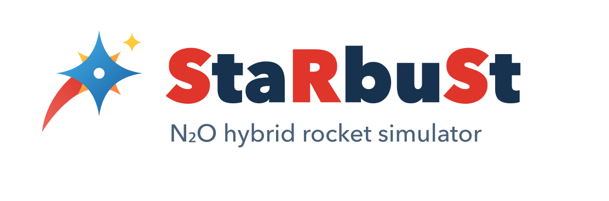
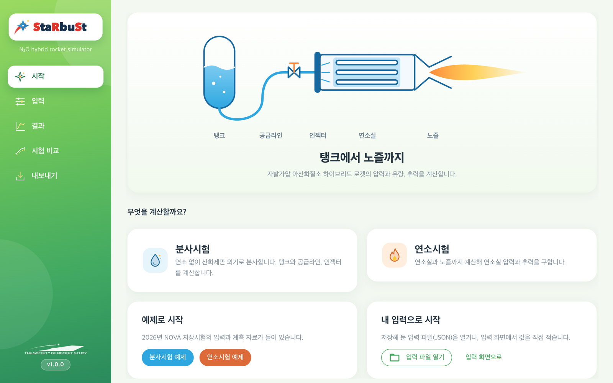
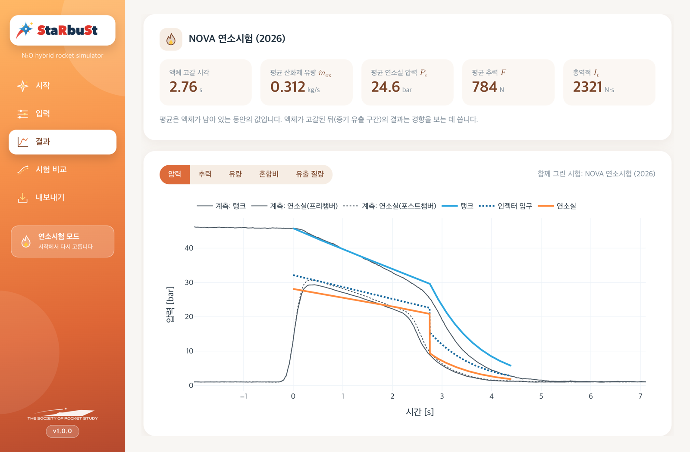
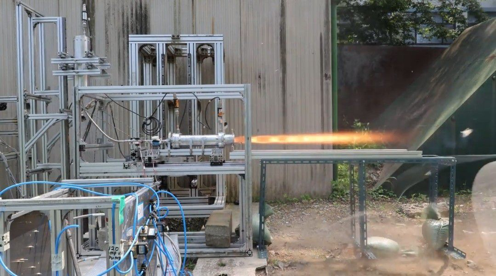
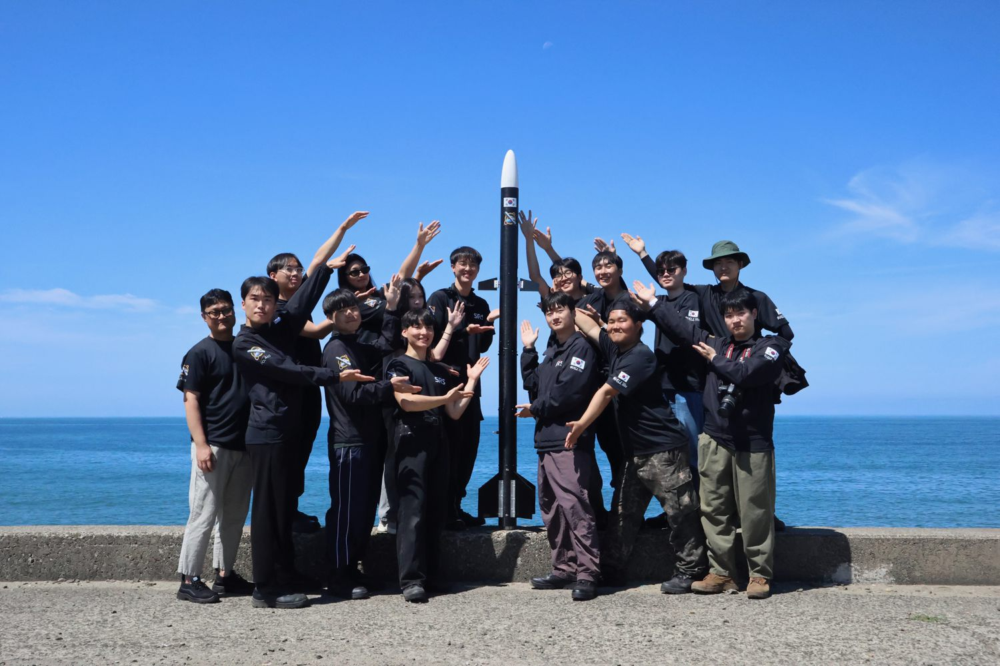
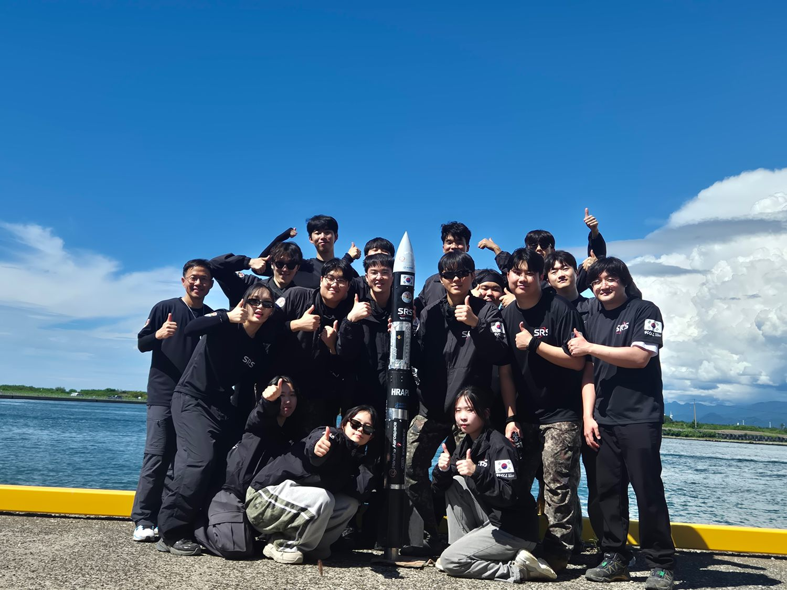

# StaRbuSt



**S**imulation **t**ool for **a**dvanced **R**ocket **bu**rning with nitrou**S** oxide propellan**t**

자발가압 아산화질소(N₂O) 하이브리드 로켓의 탱크 압력, 산화제 유량, 연소실 압력, 추력을 계산하는 프로그램이다.
탱크에서 액체가 빠지며 압력이 내려가는 과정, 공급라인에서 압력이 떨어지며 일부가 증발하는 2상 유동, 인젝터 유동, 연료 그레인의 연소, 노즐 유동을 이어서 시간에 따라 계산한다.

| 시작 화면 | 결과 화면(2026년 NOVA 연소시험 예제) |
|---|---|
|  |  |

## 설치

Python 3.11 이상이 필요하다.

```bash
pip install numpy plotly nicegui
```

`numba`가 깔려 있으면 계산이 수십 배 빨라진다(없어도 결과는 같다).

```bash
pip install numba
```

## 앱으로 설치

Python 없이 쓰려면 설치 파일로 설치한다. 설치 파일은 저장소의 Releases에 있다. 설치한 뒤에는 아이콘을 눌러 실행한다.

| 운영체제 | 설치 |
|---|---|
| macOS | `StaRbuSt-<버전>-macos-<arm64 또는 x86_64>.dmg`를 열고 StaRbuSt를 응용 프로그램 폴더로 끌어다 놓는다. Apple Silicon Mac은 arm64, Intel Mac은 x86_64 파일을 쓴다 |
| Windows | `StaRbuSt-<버전>-windows-setup.exe`를 실행한다. 시작 메뉴와 바탕 화면에 아이콘이 생긴다 |

앱을 실행하면 로컬 서버가 켜지고 화면이 앱 창으로 열린다. macOS에서는 WebKit으로, Windows에서는 WebView2로 창을 띄운다. WebView2가 없는 Windows에서는 Edge나 Chrome의 앱 창으로, 둘 다 없으면 기본 브라우저의 탭으로 화면이 열린다. 창을 닫으면 앱도 종료된다. 계산에는 인터넷 연결이 필요 없다.

- 앱에 개발자 서명이 없어서 처음 실행할 때 경고가 나온다. macOS에서는 앱을 마우스 오른쪽 버튼으로 눌러 "열기"를 고르거나 시스템 설정의 개인정보 보호 및 보안에서 "그래도 열기"를 누른다. Windows에서는 "추가 정보"를 누른 뒤 "실행"을 누른다.
- 인터넷에 연결되어 있으면 앱을 시작할 때 GitHub에서 새 버전이 있는지 확인한다. 새 버전이 있으면 화면 왼쪽 아래에 알림이 나오고, 알림을 눌러 바뀐 점을 확인한 뒤 업데이트할 수 있다.
- 로그와 계산 준비 파일은 사용자 폴더에 둔다(macOS `~/Library/Application Support/StaRbuSt`, Windows `%LOCALAPPDATA%\StaRbuSt`). 앱이 열리지 않으면 그 폴더의 `starbust.log`를 본다.

설치 파일은 `packaging/build.py`로 만든다. 실행하는 컴퓨터의 운영체제용 파일이 생성된다.

```bash
pip install pyinstaller numpy numba plotly nicegui pywebview certifi
python packaging/build.py
```

Windows에서는 `packaging/build_windows.bat`을 더블클릭해 실행해도 된다(Inno Setup 6이 있으면 설치 파일까지 만든다). 저장소의 `.github/workflows/build-app.yml`은 GitHub에서 macOS(Apple Silicon, Intel)용과 Windows용 설치 파일을 한 번에 만든다. `v1.0.0`처럼 버전 번호와 같은 태그를 올리면 Releases 초안에 설치 파일이 첨부된다.

## 실행

화면으로 쓰기:

```bash
python3 app/main.py
```

브라우저에 화면이 열린다. 시작 화면에서 예제(2026년 NOVA 분사시험, 연소시험)를 불러 계산해 볼 수 있다.
입력 화면에는 칸마다 모델 문서와 같은 기호가 붙어 있고 요소마다 핵심 수식이 함께 나온다.
화면의 색은 계산 모드를 따른다. 시작 화면은 연두색, 분사시험은 하늘색, 연소시험은 주황색이고 색은 `app/main.py` 위쪽의 `THEMES`에 있다.
공급라인 화면 아래에는 대표적인 손실계수 표가 있다. 밸브는 카탈로그의 유량계수(Cv 또는 Kv)를 입력하고, 유량계수가 없으면 보어 지름으로 어림한다.
시험 비교 화면에서는 시험 자료의 양식(CSV)을 받을 수 있고, 올린 시험 자료를 목록에 저장하거나 목록에서 뺄 수 있다(사용자 폴더의 `tests`). 수식 글꼴은 Latin Modern Math(GUST Font License, `app/assets/fonts/`)다.

코드에서 쓰기:

```python
import starbust

result = starbust.simulate('examples/nova_hot_fire.json')
print(starbust.summary(result))
```

## 폴더

| 폴더 | 내용 |
|---|---|
| `starbust/` | 계산 코드. 요소별 파일(`tank`, `feedline`, `injector`, `chamber`, `nozzle`)과 이들을 잇는 `system` |
| `starbust/data/` | N₂O 포화 물성표(CoolProp으로 계산), N₂O/HDPE 화학 평형 표(NASA CEA로 계산) |
| `app/` | 화면(NiceGUI). `main.py`가 화면, `icons.py`가 아이콘과 계통도, `equations.json`이 화면에 보이는 수식과 기호, `assets/`가 로고와 사진 |
| `examples/` | 입력 예제(JSON) |
| `testdata/` | 시험 자료(CSV와 설명 JSON) |
| `tools/` | 물성·평형 표를 만드는 스크립트, 시험 원자료 변환 스크립트, 시험 비교 스크립트, 화면의 수식을 만드는 스크립트(`make_equations.py`), 아이콘과 로고를 만드는 스크립트(`make_logo.py`) |
| `tests/` | 단위 테스트(`python3 -m pytest tests -q`) |
| `packaging/` | 설치 파일을 만드는 스크립트와 아이콘 |
| `docs/` | 코드 해설(`code_guide.md`)과 그림 |

## 모델

| 요소 | 모델 |
|---|---|
| 산화제 탱크 | 0차원, 포화 액체와 포화 증기의 열역학적 평형. 상태변수는 질량과 내부에너지 |
| 공급라인 | 1차원 균질 평형 유동(HEM). 호스·관·밸브·손실 요소를 순서대로 놓아 구성 |
| 인젝터 | 토출계수와 유량식(SPI, HEM, Dyer, FML) |
| 연소실 · 그레인 | 0차원, 후퇴율 식과 화학 평형(NASA CEA) |
| 노즐 | 평형 유동의 추력계수, 외기압과 유동 박리 반영 |

시간 적분에는 Explicit Euler 기법을 쓰고, 시간 단계마다 공급라인을 지난 유량과 인젝터 유량이 같아지는 조건(bisection)과 연소실 압력(fixed-point iteration)을 푼다.

## 입력 파일

항목 이름 끝에 단위를 붙여 적는다(`d_mm`, `L_m`, `T_C`, `P_bar`, `m_kg`). 각 항목의 뜻은 `starbust/config.py`의 설명과 `examples/`의 파일을 참고한다. 공급라인은 요소를 순서대로 나열해 적는다.

```json
"feedline": [
  {"type": "loss",  "K": 0.5},
  {"type": "hose",  "d_mm": 6.35, "L_m": 0.5, "phi": 4.44},
  {"type": "pipe",  "d_mm": 7.04, "L_m": 0.05},
  {"type": "valve", "Cv": 1.5}
]
```

밸브는 `{"type": "valve", "Cv": 1.5}` 또는 `{"type": "valve", "Kv": 1.3}`처럼 카탈로그의 유량계수로 적는다. 유량계수를 모르면 `{"type": "valve", "bore_mm": 6.35, "Cc": 0.62}`처럼 보어 지름과 수축계수를 적는다. 밸브를 오리피스로 보고 어림하는 방식이고, 안지름 7.04 mm의 관에서 이 값은 Cv 1.34에 해당한다.

## 계수

시험으로 정하는 값은 인젝터의 토출계수 `Cd`, 호스의 마찰 보정계수 `phi`, 특성속도 효율이다. 후퇴율 식은 문헌의 식에서 고르거나 계수를 직접 적는다.
`Cd`와 `phi`는 분사시험 한 번으로 정할 수 있다(화면의 "시험 비교", 코드의 `starbust.calibrate`). 토출계수는 유량식과 짝을 이루는 값이어서 유량식마다 다르다.

특성속도 효율은 연소시험 한 번으로 정할 수 있다(연소시험 모드의 "시험 비교", 코드의 `calibrate.fit_hot_fire`). 계측한 연소실 압력의 적분에 노즐 목 면적을 곱한 뒤 소모한 추진제 질량과 이론 특성속도로 나눈 값이다. 추진제 질량은 연소실로 들어간 산화제의 질량과 연료 소모량(연소 전후에 잰 그레인 질량의 차이)을 더한 값이다.

후퇴율은 `r [mm/s] = a G_ox^n (P_c / 1 MPa)^m`으로 계산한다(`G_ox`의 단위는 kg/(m²·s)). 입력의 `grain`에서 `"regression"`에 아래 식의 이름을 적으면 그 계수를 쓰고, `"custom"`을 적으면 `a`, `n`, `m`을 직접 적는다. 화면에서는 연소실 입력의 "후퇴율 식"에서 고른다. 연료(`"fuel"`)는 지금 HDPE 하나다.

| 이름 | a | n | m | 출처 |
|---|---|---|---|---|
| `ito_integral` | 0.0763 | 0.42 | 0 | Ito 외 (2021). 후퇴율을 시간에 대해 적분해 포트 반지름의 변화에 맞춘 식 |
| `ito_pressure` | 0.0308 | 0.53 | 0.43 | 같은 논문. 연소실 압력 항을 추가한 식 |
| `ito_average` | 0.0163 | 0.74 | 0 | 같은 논문. 연소 전후의 평균값으로 맞춘 식 |
| `doran` | 0.116 | 0.33 | 0 | Doran 외 (2007). Ito 외 (2021)에 인용된 값 |
| `kamps` | 0.0436 | 0.62 | 0 | Kamps 외 (2019). Ito 외 (2021)에 인용된 값 |
| `kau` | 0.0346 | 0.48 | 0 | 한국항공대학교 보고서 (2012). 7포트 HDPE 모터 |

Ito 외 (2021)는 Ito, Kamps, Nagata의 "Fuel Regression Characteristics in Hybrid Rockets Using Nitrous Oxide/High-Density Polyethylene"(Journal of Propulsion and Power 37(2))이다. 시험 범위는 산화제 질량유속 40 ~ 240 kg/(m²·s), 연소실 압력 1.1 ~ 5.0 MPa다.

벤트의 토출계수는 밸브를 닫아 둔 탱크에서 벤트로만 N₂O가 빠지는 구간의 자료로 정할 수 있다(입력 화면의 탱크, 코드의 `calibrate.fit_vent`). 탱크 질량이 있으면 질량 감소량에서 구하고, 탱크 압력만 있으면 입력한 충전량으로 탱크 상태를 계산해 압력 강하량이 같아지는 값을 찾는다.

## 시험 자료

시험 하나는 CSV(시간 이력)와 같은 이름의 JSON(채널 설명, 교정식, 시각 0의 정의)으로 되어 있다. 시각 0은 밸브를 연 시각이다.
응답이 늦은 채널은 JSON에 지연 시간(`delay_s`)을 적어 두면 읽을 때 그만큼 당겨서 다른 채널과 시각을 맞춘다. 자세한 내용은 `testdata/nova_2026/README.md`에 있다.

## 2026년 NOVA 시험과 비교

`python3 tools/nova_2026.py`를 실행하면 아래 값을 다시 계산해 `results/`에 저장한다.

| 항목 | 값 |
|---|---|
| 분사시험 1로 정한 계수(HEM) | 토출계수 0.564, 호스의 마찰 보정계수 4.44 |
| 분사시험 2(같은 계수) | 인젝터 입구 압력의 평균 제곱근 오차(RMSE) 0.11 bar, 유량 오차 +9.1 % |
| 연소시험(같은 계수, HEM) | 추력 −8.5 %, 연소실 압력 −5.3 % (밸브를 연 뒤 0.5 ~ 2.0 s 의 평균, 연소실 압력은 센서 두 개의 평균 기준) |
| 연소시험의 액체 유출 시간 | 계산 2.8 s, 계측 약 2.5 s |
| 연소시험의 총역적 | −1.1 % |

탱크는 안지름 90 mm, 높이 260 mm다. 연소시험의 충전량은 계측하지 못했다. 분사시험 두 건에서 로드셀로 잰 충전량이 1.0 ~ 1.1 kg이어서 연소시험은 1.0 kg으로 두고 계산했다. 충전량을 0.85 kg으로 두면 추력 −10.0 %, 액체 유출 시간 2.2 s이고 1.05 kg으로 두면 추력 −8.1 %, 2.9 s다.

세 시험 모두 같은 공급라인 구성을 썼다.

| 요소 | 값 | 정한 방법 |
|---|---|---|
| 탱크 출구 | K 0.5 | 가정값 |
| 플렉시블 호스 앞쪽 | 안지름 6.35 mm, 길이 0.5 m, 마찰 보정계수 4.44 | 보정계수는 분사시험 1에서 구함 |
| 호스 벤드 | K 0.3 | 가정값. 호스의 가운데에 둠 |
| 플렉시블 호스 뒤쪽 | 안지름 6.35 mm, 길이 0.5 m, 마찰 보정계수 4.44 | 앞쪽과 같은 값 |
| 관 네 구간 | 안지름 7.04 mm, 길이 0.05 m씩 | 3/8 인치 관의 안지름, 길이는 대략값 |
| 십자관(충전, 퍼지 포트) | K 0.5 | 가정값. 주 흐름이 곧게 지나가는 티의 값 |
| 볼밸브 | Cv 1.5 (K 2.33) | 카탈로그의 유량계수 |
| 티(압력 센서) | K 0.5 | 가정값 |

분사시험 1의 평균 조건(탱크 29.3 bar, 0.292 kg/s)에서 라인의 압력 강하 10.1 bar 가운데 호스가 6.5 bar, 볼밸브가 1.9 bar, 티가 0.5 bar, 십자관이 0.4 bar다. 손실계수의 가정이 달라지면 그만큼을 호스의 마찰 보정계수가 흡수한다. 십자관의 K를 2로 두면 보정계수는 3.97이 되고, 볼밸브의 Cv를 3.8로 두면 5.06이 된다.

후퇴율 식은 Ito 외 (2021)의 시간적분식(`ito_integral`, a 0.0763, n 0.42)을 그대로 썼다. 이 식으로 계산한 연료 소모량은 202 g이고 연소 전후에 잰 그레인 질량의 차이는 200 g이다. 특성속도 효율은 0.95로 두었다.
분사시험 2로 계수를 정하면 토출계수가 0.520으로 8 % 작아지고 연소시험의 추력 오차는 −13.9 %가 된다.

연소시험의 기록에 적힌 질량(산화제 1.0 kg, 연료 소모량 0.20 kg)으로 특성속도 효율을 구하면 0.87이다. 산화제 가운데 벤트로 나간 양과 탱크에 증기로 남은 양을 빼고 0.94 kg(계산값)으로 두면 0.92다. 위 표에는 0.95를 그대로 썼다.
후퇴율 식을 바꿔 계산한 연료 소모량은 `doran` 201 g, `ito_average` 205 g, `ito_pressure` 184 g, `kamps` 300 g, `kau` 119 g이다. `doran`으로 계산하면 추력 −8.5 %, 연소실 압력 −5.5 %, 총역적 −1.2 %이고, `kau`로 계산하면 추력 −11.4 %, 연소실 압력 −9.9 %, 총역적 −5.5 %다.

## 한계

- 탱크의 액체가 다 빠진 뒤(증기 유출 구간)와 밸브를 연 직후, 점화와 종료의 과도 구간은 경향만 본다. 증기 유출 구간에서 공급라인을 지나며 과열된 증기는 포화 증기의 물성으로 계산한다.
- 공급라인과 인젝터의 평형 가정, 균질 가정이 맞지 않는 조건에서는 계수에 그 오차가 반영된다. 한 조건에서 정한 계수를 다른 조건에 적용할 때는 시험으로 확인한다.
- 공급라인의 관과 호스에서는 마찰로 초킹되는 유량을 넘지 못하게 계산하지만, 밸브 같은 손실 요소에서는 초킹 여부를 따로 확인하지 않는다.
- 화학 평형 표는 N₂O와 HDPE 조합에 대해 계산한 것이다.
- numba로 컴파일한 결과는 `starbust/__pycache__/numba-…` 폴더에 저장한다. 소스나 표가 바뀌면 다시 컴파일해 새 폴더에 저장한다.

## 만든 곳

StaRbuSt는 한국항공대학교 로켓동아리 SRS(The Society of Rocket Study)에서 하이브리드 로켓을 설계하고 계산 결과를 지상시험 결과와 비교하기 위해 만들었다. SRS는 2025년과 2026년에 일본 노시로 로켓대회에 출전했고, 이 저장소의 예제와 시험 자료(`testdata/`)는 2026년 NOVA 지상시험에서 얻은 자료다. MATLAB으로 만든 이전 버전은 [StaRbuSt_mvp](https://github.com/Poesy-Lab/StaRbuSt_mvp)에 있다.

| 지상 연소시험 (2025) | 노시로 로켓대회 (2025) | 노시로 로켓대회 (2026) |
|---|---|---|
|  |  |  |

- [2025 일본 노시로 대회 준비기](https://blog.naver.com/wdh3168/223986008141)
- [KAU SRS 유튜브](https://www.youtube.com/@KAU_SRS_Rocket/videos)

아이콘의 큰 별은 예전의 액체로켓 프로젝트 Polaris(북극성)에서, 붉은 궤적은 SRS의 예전 로고에서 가져왔다. 글자는 대문자 S, R, S만 붉게 칠했다. 앱 왼쪽 아래의 SRS 로고를 누르면 사진을 더 볼 수 있다.

## 버전과 라이선스

버전마다 바뀐 점은 `CHANGELOG.md`(패치 노트)에 적는다. 버전 번호는 `starbust/__init__.py`의 `__version__` 한 곳에 적는다. 화면 왼쪽 아래와 설치 파일의 이름, 추력 곡선 파일(.eng)의 첫 줄에 이 번호가 들어간다.

코드는 MIT 라이선스다(`LICENSE`). 수식 글꼴과 SRS 로고, 사진, 설치 파일에 함께 들어가는 패키지의 라이선스 정보는 `THIRD_PARTY.md`에 적었다.
