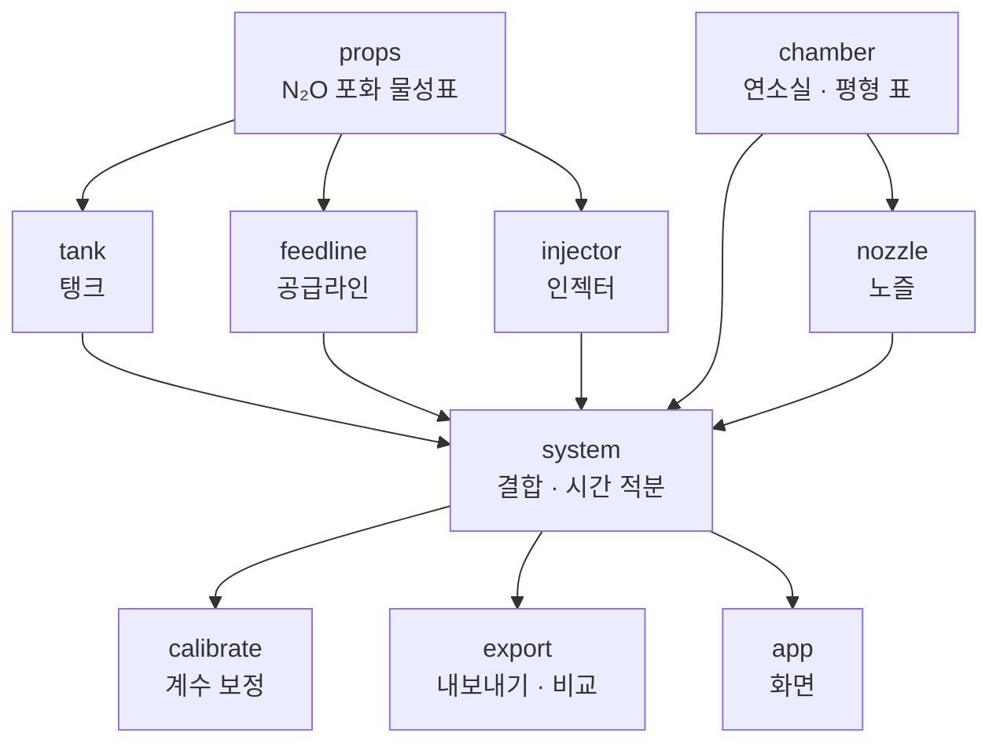
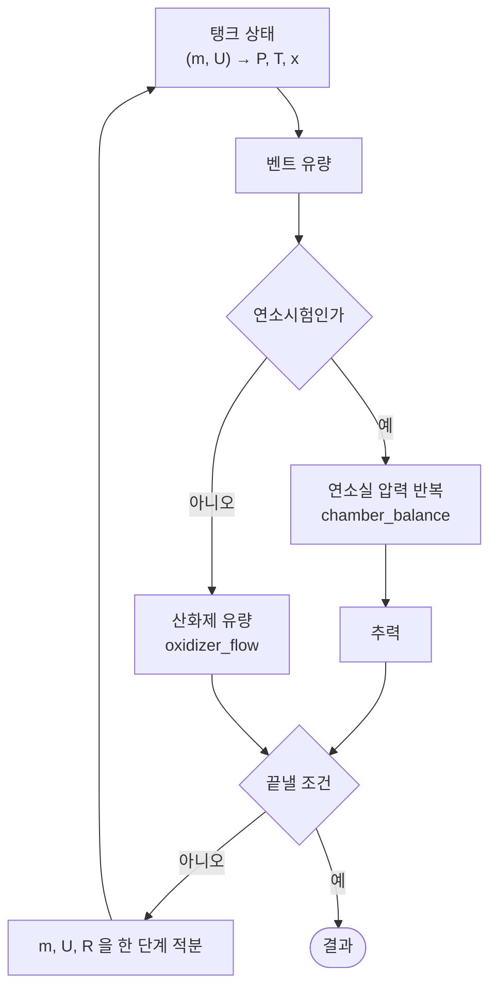

# StaRbuSt 배포판 코드 해설

이 문서는 StaRbuSt 배포판의 계산 코드를 파일 순서대로 읽는 안내서다. 모델 문서에 나온 식이 어느 함수에 들어 있는지, 그 식을 푸는 수치 방법을 어떻게 골랐는지를 적었다. 절마다 식, 코드, 숫자를 넣은 계산 예의 순서로 구성했다. 계산 예에는 2026년 NOVA 연소시험의 예제 입력을 썼고 문서의 수치는 `tools/guide_numbers.py`를 실행하면 그대로 다시 나온다.

코드는 Python으로 썼다. 계산에 필요한 패키지는 numpy 하나이고 numba가 깔려 있으면 같은 코드를 기계어로 번역해 빠르게 돌린다.

## 1. 전체 구성

### 1.1 폴더

| 폴더 | 내용 |
|---|---|
| `starbust/` | 계산 코드. 요소마다 파일 하나 |
| `starbust/data/` | N₂O 포화 물성표, N₂O/HDPE 화학 평형 표 |
| `app/` | 화면(NiceGUI). 계산 코드를 불러 쓰기만 한다 |
| `examples/` | 입력 예제(JSON) |
| `testdata/` | 시험 자료(CSV와 설명 JSON) |
| `tools/` | 표를 만드는 스크립트, 시험 원자료 변환, 시험 비교 |
| `tests/` | 자동 시험 27개 |

### 1.2 계산 코드의 파일

계산 코드는 열두 파일, 약 1,300줄이다. 모델 문서의 절 번호와 같은 순서로 놓으면 다음과 같다.

| 파일 | 줄 수 | 하는 일 | 모델 문서의 식 |
|---|---|---|---|
| `props.py` | 70 | N₂O 포화 물성표를 읽고 보간 | |
| `tank.py` | 83 | 탱크의 상태 계산, 벤트 유량 | (1.2)–(1.9) |
| `feedline.py` | 146 | 공급라인의 압력 강하와 초킹 | (2.3)–(2.15) |
| `injector.py` | 168 | 인젝터의 이론 질량유속과 유량식 네 가지 | (3.4)–(3.22) |
| `chamber.py` | 117 | 후퇴율, 연소실 압력, 화학 평형 표 | (4.3)–(4.16) |
| `nozzle.py` | 59 | 추력계수와 추력 | (5.12)–(5.17) |
| `system.py` | 207 | 요소 결합과 시간 적분 | 결합 절 |
| `config.py` | 99 | 입력 파일 읽기, 단위 환산 | |
| `testdata.py` | 90 | 시험 자료 읽기 | |
| `calibrate.py` | 255 | 시험으로 계수 보정(분사시험, 연소시험, 벤트 시험) | |
| `fuels.py` | 60 | 연료와 문헌 후퇴율 식의 프리셋 | |
| `export.py` | 68 | 결과 내보내기, 계측과 비교 | |
| `_jit.py` | 68 | numba 번역과 그 저장 | |

파일 사이의 의존 관계는 한 방향이다. 물성표와 화학 평형 표가 맨 아래에 있고, 요소 파일이 표를 읽고, `system`이 요소를 묶는다.



화살표는 "아래쪽 파일이 위쪽 파일을 불러 쓴다"는 뜻이다. 화면(`app`)은 `system`, `calibrate`, `export`만 부르고 계산 코드는 화면을 모른다.

### 1.3 계산 한 번의 흐름

```python
import starbust

result = starbust.simulate('examples/nova_hot_fire.json')
print(starbust.summary(result))
```

`simulate`는 입력 파일을 읽어 SI 단위로 바꾸고(`config.to_si`), 시간 단계마다 요소 계산을 부른 뒤, 시간 이력을 이름별 배열로 돌려준다. 결과에 든 이름은 `t`, `P_tank`, `T_tank`, `x_tank`, `m_tank`, `mdot_ox`, `mdot_vent`, `P_inj`, `x_inj`, `P_c`, `OF`, `mdot_f`, `r_dot`, `R_port`, `F`, `C_F`, `vapor`, `iterations`이고 `meta`에는 계산이 끝난 까닭과 액체 유출이 끝난 시각이 들어 있다.

### 1.4 코드를 쓴 방식

- 요소 하나에 파일 하나를 두고 파일 머리의 설명문에 그 요소의 가정과 식을 적었다. 식의 기호와 변수 이름을 맞췄다(`rho_l`, `h_v`, `x1`, `G`).
- 계산 함수는 숫자를 받아 숫자를 돌려준다. 함수 밖의 값을 바꾸지 않으므로 같은 입력에는 늘 같은 결과가 나오고 함수 하나만 떼어서 시험할 수 있다. numba가 번역할 수 있는 것도 이 때문이다.
- 계산은 전부 SI 단위다(Pa, K, kg, m, s, J). 쓰기 편한 단위(bar, ℃, mm)는 입력 파일과 화면에만 나오고 `config.to_si`에서 한 번 환산한다.

## 2. 물성표: `props.py`

### 2.1 포화선만 쓰는 까닭

탱크, 공급라인, 인젝터의 모델은 모두 액체와 증기가 평형인 포화 상태를 가정한다. 포화 상태의 물성은 압력 하나로 정해지므로 필요한 것은 포화선 위의 값뿐이다. 그래서 상태방정식을 계산 중에 부르지 않고 포화선의 값을 미리 표로 만들어 두고 읽는다.

표(`data/n2o_saturation.csv`)는 Lemmon–Span(2006) 상태방정식을 CoolProp으로 계산한 것이다. 압력 0.90 bar(삼중점 바로 위)부터 72.00 bar(임계점 바로 아래)까지 2000점이고 압력의 로그에 대해 간격이 일정하다. 이웃한 두 점의 압력은 0.22 % 다르다. 점성계수는 상태방정식에서 나오지 않아 ESDU 91022의 상관식으로 계산해 같은 표에 넣었다. 표를 만드는 스크립트는 `tools/make_n2o_table.py`다.

### 2.2 `sat(P)`

```python
@njit
def sat(P):
    pos = (math.log(P) - _LNP0) / _DLNP
    if pos < 0.0:
        pos = 0.0
    elif pos > _N - 1.0:
        pos = _N - 1.0
    i = int(pos)
    if i > _N - 2:
        i = _N - 2
    w = pos - i
    a = _TAB[i]
    b = _TAB[i + 1]
    return (a[0] + w * (b[0] - a[0]), a[1] + w * (b[1] - a[1]), ...)
```

표의 간격이 $\ln P$에 대해 일정하므로 $P$가 놓인 칸은 찾지 않고 계산한다. `pos`의 정수 부분이 칸 번호이고 소수 부분 `w`가 그 칸 안의 위치다. 돌려주는 값은 열세 개이고 순서는 포화 온도 `T`, 액체와 증기의 밀도 `rho_l`·`rho_v`, 엔탈피 `h_l`·`h_v`, 엔트로피 `s_l`·`s_v`, 내부에너지 `u_l`·`u_v`, 음속 `a_l`·`a_v`, 점성계수 `mu_l`·`mu_v`다. 다른 파일에서는 이 열세 값을 한 줄에 풀어 받는다.

```python
T, rho_l, rho_v, h_l, h_v, s_l, s_v, u_l, u_v, a_l, a_v, mu_l, mu_v = sat(P)
```

온도에서 포화 압력을 구하는 `psat(T)`는 `sat`를 뒤집은 것이다. 포화 온도가 압력에 따라 단조 증가하므로 이분법으로 찾는다.

### 2.3 계산 예와 정확도

`sat(40 bar)`는 포화 온도 9.99 ℃, 액체 밀도 852.2 kg/m³, 증기 밀도 114.9 kg/m³, 액체 엔탈피 188.6 kJ/kg, 증기 엔탈피 393.5 kJ/kg, 액체 음속 483.7 m/s, 증기 음속 205.5 m/s를 돌려준다. `psat(15.7 ℃)`는 45.78 bar다.

표의 점 사이 4001곳(1–70 bar)에서 CoolProp의 값과 비교하면 온도의 상대 차이는 2×10⁻⁸, 밀도는 5×10⁻⁵ 이하, 엔탈피는 증발열의 6×10⁻⁵ 이하다. 보간에서 생기는 오차는 모델의 다른 불확도에 견주어 무시할 수 있다.

표의 범위를 벗어난 압력에는 끝값을 돌려준다. 반복 계산 도중에 잠깐 범위를 벗어나도 계산이 멈추지 않게 하려는 것이다. 다만 사용자가 준 처음 온도나 처음 압력이 범위 밖이면 `config.to_si`와 `tank.initial_state`가 계산을 시작하기 전에 거절한다.

## 3. 탱크: `tank.py`

### 3.1 상태변수와 식

탱크는 부피가 일정하고 단열이며 액체와 증기가 온도와 압력이 같은 포화 상태라고 본다. 상태변수는 탱크 안 N₂O의 총질량 $m$과 총내부에너지 $U$다.

$$\frac{dm}{dt} = -\dot m_{ox} - \dot m_{vent}, \qquad \frac{dU}{dt} = -\dot m_{ox}\,h_{out} - \dot m_{vent}\,h_v$$

$h_{out}$은 액체가 남아 있으면 포화 액체의 엔탈피 $h_l$, 다 빠진 뒤에는 포화 증기의 엔탈피 $h_v$다. 이 두 식의 적분은 `system.py`가 하고 `tank.py`에는 $(m, U)$에서 압력을 구하는 계산이 있다.

$m$과 $U$가 정해지면 비체적 $v = V/m$과 비내부에너지 $u = U/m$이 정해진다. 포화 혼합물이므로

$$v = x\,v_v(P) + (1-x)\,v_l(P), \qquad u = x\,u_v(P) + (1-x)\,u_l(P)$$

이고 미지수는 압력 $P$와 건도 $x$ 둘이다.

### 3.2 `tank_state`

```python
@njit
def _residual(P, v, u):
    T, rho_l, rho_v, h_l, h_v, s_l, s_v, u_l, u_v, a_l, a_v, mu_l, mu_v = sat(P)
    v_l = 1.0 / rho_l
    v_v = 1.0 / rho_v
    x = (v - v_l) / (v_v - v_l)
    return u_l + x * (u_v - u_l) - u, x, T


@njit
def tank_state(m, U, V):
    v = V / m
    u = U / m
    lo, hi = P_MIN, P_MAX
    for _ in range(60):
        mid = math.sqrt(lo * hi)
        if _residual(mid, v, u)[0] < 0.0:
            lo = mid
        else:
            hi = mid
    P = math.sqrt(lo * hi)
    r, x, T = _residual(P, v, u)
    return P, T, x
```

`_residual`은 압력을 하나 가정하고 첫째 식에서 건도를 구한 뒤, 그 건도로 계산한 내부에너지에서 실제 값 $u$를 뺀다. 이 차이가 0이 되는 압력이 답이다. 비체적을 고정하고 압력(온도)을 올리면 혼합물의 내부에너지가 커지므로 차이는 압력에 따라 단조 증가한다. 해가 하나뿐이고 양 끝의 부호가 다르므로 이분법을 썼다. 압력의 범위가 0.9–72 bar로 넓어서 구간의 가운데를 기하평균(`sqrt(lo * hi)`)으로 잡는다. 60번 반복하면 구간의 폭은 처음의 $2^{-60}$이 된다.

### 3.3 계산 예

예제 입력의 탱크는 안지름 90 mm, 높이 260 mm(부피 1.654 L)이고 15.7 ℃에서 1.0 kg을 채운다.

1. `initial_state`가 처음 상태를 만든다. 비체적은 $V/m$ = 1.654 L/kg이고 15.7 ℃의 포화 액체와 포화 증기의 비체적은 1.226, 7.288 L/kg이므로 건도는 (1.654 − 1.226)/(7.288 − 1.226) = 0.071이다. 내부에너지는 1.0 × [197.2 + 0.071 × (355.6 − 197.2)] = 208.4 kJ이다. 부피로 보면 69 %가 액체다.
2. `tank_state(1.0, 208.43e3, 1.654e-3)`은 45.78 bar, 15.7 ℃, 건도 0.071을 돌려준다. 처음 상태를 만든 계산을 거꾸로 푼 것이어서 같은 값이 나와야 하고 자동 시험이 이것을 확인한다.
3. 포화 액체가 0.31 kg/s로 0.01 s 동안 나가면 질량은 3.1 g, 내부에너지는 0.63 kJ 줄어든다. 새 상태로 `tank_state`를 부르면 압력이 45.725 bar로 0.052 bar 내려간다. 액체가 빠진 부피를 채우려고 액체 일부가 증발하고 증발열만큼 온도가 내려가 포화 압력이 낮아진 결과다.

### 3.4 벤트: `vent_mdot`

벤트로는 탱크의 포화 증기가 작은 오리피스를 등엔트로피로 지난다고 본다. 지수는 포화 증기의 밀도와 음속에서 $n = \rho_v a_v^2 / P$로 구하고 외기압이 임계 압력 $r^* P$ 이하이면 초킹된 식을 쓴다.

```python
n = rho_v * a_v * a_v / P
r_crit = (2.0 / (n + 1.0)) ** (n / (n - 1.0))
r = P_amb / P
if r <= r_crit:
    return CdA * math.sqrt(n * P * rho_v * (2.0 / (n + 1.0)) ** ((n + 1.0) / (n - 1.0)))
return CdA * math.sqrt(2.0 * n / (n - 1.0) * P * rho_v * (r ** (2.0 / n) - r ** ((n + 1.0) / n)))
```

45.78 bar에서 $n$ = 1.22이고 지름 1.59 mm에 토출계수 0.1인 벤트(유효 면적 0.198 mm²)의 유량은 3.2 g/s다. 인젝터로 나가는 유량의 1 %쯤이다.

## 4. 공급라인: `feedline.py`

### 4.1 식

공급라인은 정상·단열 1차원 유동이고 액체와 증기의 속도와 온도가 같다고 본다(균질 평형). 운동에너지의 변화를 무시하면 엔탈피가 입구 값 $h_0$로 유지된다. 압력이 내려가면 포화 액체의 엔탈피가 작아지므로 그 차이만큼 증발한다.

$$x = \frac{h_0 - h_l(P)}{h_v(P) - h_l(P)}, \qquad v = x\,v_v(P) + (1-x)\,v_l(P)$$

곧은 구간의 운동량 식과 길이가 없는 손실 요소의 식은 다음과 같다. $G = \dot m / A$는 질량유속이다.

$$-\frac{dP}{dz} = \varphi\,\frac{f}{D}\,\frac{G^2 v}{2} + G^2\frac{dv}{dz}, \qquad P_{in} - P_{out} = K\,\frac{G^2 v_{in}}{2} + G^2\,(v_{out} - v_{in})$$

마찰계수는 $f = 0.0032 + 0.221\,\mathrm{Re}^{-0.237}$, 레이놀즈 수는 $\mathrm{Re} = GD/\mu$이고 혼합물의 점성계수는 보이드율 $\alpha$로 가중 평균한다. $\varphi$는 주름진 호스처럼 매끄러운 관보다 마찰이 큰 구간에 곱하는 보정계수다.

### 4.2 `mixture`

```python
@njit
def mixture(P, h0):
    T, rho_l, rho_v, h_l, h_v, s_l, s_v, u_l, u_v, a_l, a_v, mu_l, mu_v = sat(P)
    x = (h0 - h_l) / (h_v - h_l)
    if x < 0.0:
        x = 0.0
    elif x > 1.0:
        x = 1.0
    v_l = 1.0 / rho_l
    v_v = 1.0 / rho_v
    v = v_l + x * (v_v - v_l)
    alpha = x * v_v / v
    return x, v, alpha * mu_v + (1.0 - alpha) * mu_l
```

엔탈피가 $h_0$인 혼합물이 압력 $P$에 있을 때의 건도, 비체적, 점성계수다. 40 bar의 포화 액체가 30 bar까지 내려오면 건도 0.112, 비체적 2.34 L/kg(포화 액체의 2.0배)이 된다.

### 4.3 압력 쪽으로 적분하는 까닭

운동량 식을 $dP/dz$에 대해 풀면 분모에 $1 - G^2\,|dv/dP|$가 나온다. 질량유속이 커져 이 값이 0에 가까워지면 압력 구배가 한없이 커지고 0이 되는 곳이 초킹이다. 거리 $z$를 일정한 간격으로 나누어 전진하면 이 근처에서 한 칸의 압력 강하가 급격히 커져서, 간격을 줄여도 초킹되는 지점을 지나쳐 버리기 쉽다.

그래서 독립변수를 바꿨다. 압력을 일정한 비율(0.2 %)씩 낮추고 그만큼 내려가는 동안 지나온 길이를 구한다. 압력을 $P_a$에서 $P_b$로 낮추면 비체적이 $v_a$에서 $v_b$로 커진다. 낮춘 압력 가운데 $G^2 (v_b - v_a)$는 유체를 가속하는 데 쓰이고 나머지를 마찰이 가져간다.

$$\text{rest} = (P_a - P_b) - G^2\,(v_b - v_a), \qquad \Delta z = \frac{\text{rest}}{\varphi\,(f/D)\,G^2\,\bar v / 2}$$

길이를 더해 가다가 구간의 길이에 이르면 그때의 압력이 출구 압력이다. 나머지가 0 이하이면 낮춘 압력을 가속이 전부 쓰고도 모자란다는 뜻이므로 그 유량은 지나갈 수 없다. 이 조건은 $G^2 \ge -1/(dv/dP)_h$와 같고 균질 평형 유동의 임계 질량유속에 이르렀다는 뜻이다.

### 4.4 `element_outlet`

```python
@njit
def element_outlet(P_in, G, h0, d, L, phi, K):
    if G <= 0.0:
        return P_in
    x_a, v_a, mu_a = mixture(P_in, h0)
    P_a = P_in
    done = 0.0
    goal = L if L > 0.0 else K * G * G * v_a / 2.0
    if goal <= 0.0:
        return P_in
    while True:
        P_b = P_a * (1.0 - REL_STEP)
        if P_b < P_FLOOR:
            return -1.0
        x_b, v_b, mu_b = mixture(P_b, h0)
        rest = (P_a - P_b) - G * G * (v_b - v_a)
        if rest <= 0.0:
            return -1.0
        if L > 0.0:
            Re = G * d / (0.5 * (mu_a + mu_b))
            f = 0.0032 + 0.221 * Re ** (-0.237)
            gain = rest / (phi * f / d * G * G * 0.5 * (v_a + v_b) / 2.0)
        else:
            gain = rest
        if done + gain >= goal:
            return P_a - (goal - done) / gain * (P_a - P_b)
        done += gain
        P_a, v_a, mu_a = P_b, v_b, mu_b
```

곧은 구간과 손실 요소를 한 함수로 다룬다. 곧은 구간(`L > 0`)에서는 `done`이 지나온 길이이고 목표 `goal`은 구간의 길이다. 손실 요소(`L = 0`)에서는 `done`이 손실이 가져간 압력이고 목표는 $K G^2 v_{in}/2$다. 어느 쪽이든 목표를 넘는 칸에서 선형으로 나누어 출구 압력을 정한다. 지나갈 수 없는 유량이면 −1을 돌려주고 부르는 쪽이 이 값을 보고 유량을 줄인다.

`line_outlet`은 요소를 상류부터 차례로 지나며 이 함수를 부른다. 요소마다 안지름이 다르므로 질량유속을 그때마다 다시 구한다.

### 4.5 요소 목록: `build`

사용자는 공급라인을 요소의 목록으로 적는다. 요소는 곧은 관(`pipe`), 호스(`hose`), 손실 요소(`loss`), 밸브(`valve`) 네 가지다.

```json
"feedline": [
  {"type": "loss",  "name": "탱크 출구", "K": 0.5},
  {"type": "hose",  "name": "플렉시블 호스", "d_mm": 6.35, "L_m": 1.0, "phi": 4.63},
  {"type": "loss",  "name": "호스 벤드", "K": 0.4},
  {"type": "pipe",  "name": "관 1", "d_mm": 7.747, "L_m": 0.05},
  {"type": "valve", "name": "볼밸브", "bore_mm": 6.4, "Cc": 0.62},
  {"type": "pipe",  "name": "관 2", "d_mm": 7.747, "L_m": 0.05}
]
```

`build`는 이 목록을 길이가 같은 배열 네 개 `(d, L, phi, K)`로 바꾼다. numba로 번역한 함수는 사전의 목록을 다루지 못하고 숫자 배열만 받기 때문이다. 밸브의 손실계수는 `valve_loss`가 정한다. 카탈로그의 유량계수가 있으면 그 정의에서 $K = 2.14\times10^{-3} D^4 / C_v^2$ 또는 $K = 1.60\times10^{-3} D^4 / K_v^2$로 구하고($D$는 mm), 없으면 보어 면적 $A_b$와 수축계수 $C_c$에서 $K = (A / (C_c A_b))^2 - 1$로 어림한다. 위 예의 볼밸브는 $K$ = 4.59이고 유량계수로는 $C_v$ = 1.30에 해당한다. 손실 요소의 기준 안지름은 따로 적지 않으면 바로 앞 곧은 구간의 값을 쓴다. 밸브가 둘이거나 호스가 없는 구성도 목록만 바꾸면 계산된다.

### 4.6 계산 예

40 bar의 포화 액체가 0.31 kg/s로 위 라인을 지난다.

| 요소 | 질량유속 [kg/(m² s)] | 입구 → 출구 [bar] | 압력 강하 [bar] | 출구 건도 |
|---|---|---|---|---|
| 탱크 출구 | 9,789 | 40.00 → 39.69 | 0.31 | 0.004 |
| 플렉시블 호스 | 9,789 | 39.69 → 33.09 | 6.61 | 0.079 |
| 호스 벤드 | 9,789 | 33.09 → 32.67 | 0.42 | 0.083 |
| 관 1 | 6,577 | 32.67 → 32.64 | 0.03 | 0.084 |
| 볼밸브 | 6,577 | 32.64 → 30.57 | 2.07 | 0.106 |
| 관 2 | 6,577 | 30.57 → 30.54 | 0.04 | 0.106 |

인젝터 입구에서 압력은 30.54 bar, 건도는 0.106이다. 탱크 압력의 24 %가 라인에서 사라지고 그 대부분은 호스(6.6 bar)와 밸브(2.1 bar)의 몫이다. 유량을 늘리면 압력 강하가 커지고 0.393 kg/s에서 라인 끝의 질량유속이 임계 질량유속에 이른다. 이 라인은 40 bar에서 그보다 많은 유량을 보내지 못한다.

<!-- fig:line_profile -->
```tikz
% ga: scale=1.5 alt="공급라인을 따라 본 압력과 건도. 40 bar 포화 액체가 0.31 kg/s 로 흐를 때 압력은 호스 1 m 에서 약 6.6 bar, 밸브에서 약 2.1 bar 내려가고 건도는 출구에서 0.11 가 된다"
% tools/guide_numbers.py --figures 가 만든 파일이다.
\begin{tikzpicture}
  \begin{axis}[ga, xmin=0, xmax=1.12, ymin=26, ymax=41, width=11cm, height=6.6cm, xlabel={라인을 따라 잰 거리 $z$ \;[m]}, ylabel={$P$ \;[bar]}, xtick={0,0.25,0.5,0.75,1}, ytick={28,32,36,40}]
    \addplot[gamain] coordinates {(0.0000,40.0000) (0.0000,39.6941) (0.0250,39.5603) (0.0500,39.4253) (0.0750,39.2891) (0.1000,39.1515) (0.1250,39.0127) (0.1500,38.8726) (0.1750,38.7312) (0.2000,38.5884) (0.2250,38.4443) (0.2500,38.2987) (0.2750,38.1517) (0.3000,38.0032) (0.3250,37.8532) (0.3500,37.7017) (0.3750,37.5487) (0.4000,37.3940) (0.4250,37.2377) (0.4500,37.0797) (0.4750,36.9200) (0.5000,36.7586) (0.5250,36.5954) (0.5500,36.4304) (0.5750,36.2635) (0.6000,36.0946) (0.6250,35.9238) (0.6500,35.7510) (0.6750,35.5762) (0.7000,35.3992) (0.7250,35.2201) (0.7500,35.0387) (0.7750,34.8551) (0.8000,34.6691) (0.8250,34.4807) (0.8500,34.2898) (0.8750,34.0963) (0.9000,33.9003) (0.9250,33.7015) (0.9500,33.4999) (0.9750,33.2955) (1.0000,33.0881) (1.0000,32.6724) (1.0013,32.6716) (1.0025,32.6708) (1.0038,32.6699) (1.0050,32.6691) (1.0063,32.6683) (1.0075,32.6675) (1.0088,32.6666) (1.0100,32.6658) (1.0113,32.6650) (1.0125,32.6642) (1.0138,32.6633) (1.0150,32.6625) (1.0163,32.6617) (1.0175,32.6609) (1.0188,32.6600) (1.0200,32.6592) (1.0212,32.6584) (1.0225,32.6576) (1.0237,32.6567) (1.0250,32.6559) (1.0262,32.6551) (1.0275,32.6543) (1.0287,32.6534) (1.0300,32.6526) (1.0312,32.6518) (1.0325,32.6510) (1.0337,32.6501) (1.0350,32.6493) (1.0362,32.6485) (1.0375,32.6477) (1.0387,32.6468) (1.0400,32.6460) (1.0412,32.6452) (1.0425,32.6444) (1.0437,32.6435) (1.0450,32.6427) (1.0462,32.6419) (1.0475,32.6410) (1.0487,32.6402) (1.0500,32.6394) (1.0500,30.5726) (1.0512,30.5716) (1.0525,30.5707) (1.0537,30.5698) (1.0550,30.5688) (1.0562,30.5679) (1.0575,30.5669) (1.0587,30.5660) (1.0600,30.5650) (1.0612,30.5641) (1.0625,30.5631) (1.0637,30.5622) (1.0650,30.5612) (1.0662,30.5603) (1.0675,30.5593) (1.0687,30.5584) (1.0700,30.5574) (1.0712,30.5565) (1.0725,30.5555) (1.0737,30.5546) (1.0750,30.5536) (1.0762,30.5527) (1.0775,30.5517) (1.0787,30.5508) (1.0800,30.5498) (1.0812,30.5489) (1.0825,30.5480) (1.0837,30.5470) (1.0850,30.5461) (1.0862,30.5451) (1.0875,30.5442) (1.0887,30.5432) (1.0900,30.5423) (1.0912,30.5413) (1.0925,30.5404) (1.0937,30.5394) (1.0950,30.5385) (1.0962,30.5375) (1.0975,30.5366) (1.0987,30.5356) (1.1000,30.5347)};
    \addplot[gaalt] coordinates {(0.0000,26.0000) (0.0000,26.3735) (0.0250,26.5361) (0.0500,26.6996) (0.0750,26.8641) (0.1000,27.0296) (0.1250,27.1961) (0.1500,27.3637) (0.1750,27.5324) (0.2000,27.7021) (0.2250,27.8729) (0.2500,28.0449) (0.2750,28.2180) (0.3000,28.3923) (0.3250,28.5678) (0.3500,28.7445) (0.3750,28.9225) (0.4000,29.1019) (0.4250,29.2825) (0.4500,29.4645) (0.4750,29.6479) (0.5000,29.8328) (0.5250,30.0191) (0.5500,30.2069) (0.5750,30.3963) (0.6000,30.5873) (0.6250,30.7799) (0.6500,30.9741) (0.6750,31.1701) (0.7000,31.3678) (0.7250,31.5674) (0.7500,31.7688) (0.7750,31.9721) (0.8000,32.1774) (0.8250,32.3847) (0.8500,32.5942) (0.8750,32.8058) (0.9000,33.0196) (0.9250,33.2358) (0.9500,33.4543) (0.9750,33.6754) (1.0000,33.8990) (1.0000,34.3450) (1.0013,34.3459) (1.0025,34.3468) (1.0038,34.3477) (1.0050,34.3486) (1.0063,34.3495) (1.0075,34.3503) (1.0088,34.3512) (1.0100,34.3521) (1.0113,34.3530) (1.0125,34.3539) (1.0138,34.3548) (1.0150,34.3556) (1.0163,34.3565) (1.0175,34.3574) (1.0188,34.3583) (1.0200,34.3592) (1.0212,34.3601) (1.0225,34.3609) (1.0237,34.3618) (1.0250,34.3627) (1.0262,34.3636) (1.0275,34.3645) (1.0287,34.3654) (1.0300,34.3662) (1.0312,34.3671) (1.0325,34.3680) (1.0337,34.3689) (1.0350,34.3698) (1.0362,34.3707) (1.0375,34.3716) (1.0387,34.3724) (1.0400,34.3733) (1.0412,34.3742) (1.0425,34.3751) (1.0437,34.3760) (1.0450,34.3769) (1.0462,34.3777) (1.0475,34.3786) (1.0487,34.3795) (1.0500,34.3804) (1.0500,36.5634) (1.0512,36.5644) (1.0525,36.5654) (1.0537,36.5664) (1.0550,36.5674) (1.0562,36.5684) (1.0575,36.5694) (1.0587,36.5704) (1.0600,36.5714) (1.0612,36.5723) (1.0625,36.5733) (1.0637,36.5743) (1.0650,36.5753) (1.0662,36.5763) (1.0675,36.5773) (1.0687,36.5783) (1.0700,36.5793) (1.0712,36.5803) (1.0725,36.5812) (1.0737,36.5822) (1.0750,36.5832) (1.0762,36.5842) (1.0775,36.5852) (1.0787,36.5862) (1.0800,36.5872) (1.0812,36.5882) (1.0825,36.5892) (1.0837,36.5902) (1.0850,36.5911) (1.0862,36.5921) (1.0875,36.5931) (1.0887,36.5941) (1.0900,36.5951) (1.0912,36.5961) (1.0925,36.5971) (1.0937,36.5981) (1.0950,36.5991) (1.0962,36.6000) (1.0975,36.6010) (1.0987,36.6020) (1.1000,36.6030)};
    \node[lab, anchor=south west, text=gamain] at (axis cs:0.30,38.30) {압력 $P$};
    \node[lab, anchor=north west, text=gaalt] at (axis cs:0.42,28.85) {건도 $x$ (오른쪽 눈금)};
    \node[lab, anchor=south east] at (axis cs:1.0,40.0) {호스};
    \node[lab, anchor=north west] at (axis cs:1.055,33.13) {밸브};
    \draw[ext] (axis cs:1.0,26) -- (axis cs:1.0,41);
    \node[lab, anchor=west, text=gaalt] at (axis cs:1.125,26) {0};
    \node[lab, anchor=west, text=gaalt] at (axis cs:1.125,31) {0.05};
    \node[lab, anchor=west, text=gaalt] at (axis cs:1.125,36) {0.10};
  \end{axis}
\end{tikzpicture}
```
> 그림 1. 공급라인을 따라 본 압력과 건도(40 bar 포화 액체, 0.31 kg/s). 세로선은 호스의 끝이고 그 뒤 0.1 m 구간에 관과 볼밸브가 있다.

### 4.7 확인한 것

- 모델 문서의 전진 계산식(구간을 잘게 나누어 마찰과 가속을 차례로 빼는 방법)을 0.5 mm 간격으로 계산한 값과 출구 압력이 0.006 bar 안에서 같다.
- 라인이 보낼 수 있는 최대 유량에서 관 끝의 질량유속은 $\sqrt{-1/(dv/dP)_h}$와 1 % 안에서 같다.

## 5. 인젝터: `injector.py`

### 5.1 식

오리피스는 정상·단열 1차원 유동이고 마찰과 입구 유속을 무시한다. 에너지 보존과 등엔트로피 관계에서 이론 질량유속은

$$G = \frac{1}{v_2}\sqrt{2\int_{P_2}^{P_1} v\,dP}$$

이고 팽창하는 동안 비체적 $v$가 어떻게 변한다고 보는지에 따라 유량식이 갈린다. 실제 유량은 $\dot m = C_d A\,G$다.

| 유량식 | 팽창 중의 가정 | 이론 질량유속 |
|---|---|---|
| SPI | 증발 없음, 비체적 일정 | $\sqrt{2\rho_1 (P_1 - P_2)}$ |
| SPC | 증발 없음, 비체적은 압력에 따라 변함 | $\sqrt{\dfrac{2n}{n-1}\rho_1 P_1\left[r^{2/n} - r^{(n+1)/n}\right]}$, $r = \max(P_2/P_1,\ r^*)$ |
| HEM | 평형을 유지하며 등엔트로피 팽창 | $\sqrt{2(h_1 - h_2)}\,/\,v_2$, 초킹 뒤에는 최댓값 |
| Dyer | SPI와 HEM의 가중 평균 | $\dfrac{\kappa}{1+\kappa}G_{SPI} + \dfrac{1}{1+\kappa}G_{HEM}$ |
| FML | SPC와 HEM을 출구 보이드율로 가중 평균 | $(1-\alpha_2)\,G_{SPC} + \alpha_2\,G_{HEM}$, 합이 최대인 압력에서 초킹 |

입구(단면 1)는 압력 $P_1$과 건도 $x_1$으로 준다. 공급라인을 지나며 일부가 증발했으므로 $x_1$은 0보다 크다.

### 5.2 입구 상태: `inlet`

```python
@njit
def inlet(P1, x1):
    T, rho_l, rho_v, h_l, h_v, s_l, s_v, u_l, u_v, a_l, a_v, mu_l, mu_v = sat(P1)
    v_l = 1.0 / rho_l
    v_v = 1.0 / rho_v
    v1 = v_l + x1 * (v_v - v_l)
    n = v1 / (P1 * (x1 * v_v * v_v / (a_v * a_v) + (1.0 - x1) * v_l * v_l / (a_l * a_l)))
    return 1.0 / v1, h_l + x1 * (h_v - h_l), s_l + x1 * (s_v - s_l), n
```

`n`은 SPC에 쓰는 등엔트로피 지수다. 증발이 없다고 보는 식이므로 건도를 고정한 혼합물의 압축성으로 정의했다. 건도가 고정되면 $(\partial v/\partial P)_s = -[x_1 v_v^2/a_v^2 + (1-x_1) v_l^2/a_l^2]$이고 $n = -(v/P)/(\partial v/\partial P)_s$다. 입구가 포화 액체이면 $n = \rho_l a_l^2/P_1$, 포화 증기이면 $n = \rho_v a_v^2/P_1$이 되어 양 끝에서 익숙한 값과 이어진다. 40 bar의 포화 액체는 $n$ = 49.8로 거의 비압축성이고 건도 0.106인 30.54 bar의 혼합물은 $n$ = 2.13이다. 증기가 조금만 섞여도 혼합물은 압축성 유체처럼 거동한다.

### 5.3 HEM과 초킹: `hem_exit`, `hem_critical`

```python
@njit
def hem_exit(h1, s1, P2):
    T, rho_l, rho_v, h_l, h_v, s_l, s_v, u_l, u_v, a_l, a_v, mu_l, mu_v = sat(P2)
    x2 = (s1 - s_l) / (s_v - s_l)
    ...
    h2 = h_l + x2 * (h_v - h_l)
    v2 = 1.0 / rho_l + x2 * (1.0 / rho_v - 1.0 / rho_l)
    G = math.sqrt(2.0 * (h1 - h2)) / v2 if h1 > h2 else 0.0
    ...
    alpha2 = 1.0 / (1.0 + (1.0 - x2) / x2 * (rho_v / rho_l) ** (2.0 / 3.0))
    return G, alpha2
```

출구 압력 $P_2$까지 엔트로피를 유지하며 팽창했다고 보고 출구의 건도, 엔탈피, 비체적을 구한다. 엔탈피가 줄어든 만큼이 운동에너지다. 함께 돌려주는 `alpha2`는 FML의 가중치로 쓰는 출구 보이드율이고 Zivi의 슬립비로 구한다.

배압을 낮추면 엔탈피 차이는 커지지만 출구의 비체적도 커진다. 그래서 $G$는 어떤 압력 $P^*$에서 최댓값을 지나고 그보다 낮은 배압에서는 줄어든다. 실제 유동은 최댓값에 머문다(초킹). `hem_critical`은 이 최댓값을 황금분할 탐색으로 찾는다.

```python
@njit
def hem_critical(P1, h1, s1):
    a, b = P_LOW, P1
    c = b - _GOLD * (b - a)
    d = a + _GOLD * (b - a)
    fc = hem_exit(h1, s1, c)[0]
    fd = hem_exit(h1, s1, d)[0]
    for _ in range(48):
        if fc > fd:
            b, d, fd = d, c, fc
            c = b - _GOLD * (b - a)
            fc = hem_exit(h1, s1, c)[0]
        else:
            a, c, fc = c, d, fd
            d = a + _GOLD * (b - a)
            fd = hem_exit(h1, s1, d)[0]
    P_star = 0.5 * (a + b)
    return P_star, hem_exit(h1, s1, P_star)[0]
```

황금분할 탐색은 구간 안의 두 점에서 함숫값을 비교해 최댓값이 없는 쪽을 버린다. 미분이 필요 없어서 표를 보간한 함수에 쓰기 좋다. 한 번에 구간이 0.618배로 줄고 48번이면 처음의 10⁻¹⁰이 된다.

### 5.4 FML: `g_fml`

FML은 SPC와 HEM의 값을 출구 보이드율로 가중해 더한다. 액체 유출 구간에서는 SPC에 $(1-\alpha_2)$, HEM에 $\alpha_2$를 곱하고 증기 유출 구간에서는 두 가중치를 바꾼다. 배압을 낮추면 이 합도 최댓값을 지나므로 합이 최대인 압력 $P_F$를 찾아 그보다 낮은 배압에서는 최댓값에 머물게 했다. 합은 극대점이 하나라는 보장이 없어서 먼저 80개 점으로 훑어 가장 큰 값이 있는 칸을 찾고 그 칸 안에서 황금분할 탐색을 한다.

### 5.5 유량식 고르기: `mass_flux`

```python
@njit
def mass_flux(model, P1, x1, P2, vapor):
    if P2 >= P1:
        return 0.0
    rho1, h1, s1, n = inlet(P1, x1)
    if model == FML:
        return g_fml(rho1, n, h1, s1, P1, P2, vapor)
    if model == HEM:
        P_star, G_star = hem_critical(P1, h1, s1)
        return G_star if P2 < P_star else hem_exit(h1, s1, P2)[0]
    if vapor:
        return g_spc(rho1, n, P1, P2)
    if model == SPI:
        return g_spi(rho1, P1, P2)
    P_sat1 = P1
    kappa = math.sqrt((P1 - P2) / (P_sat1 - P2))
    P_star, G_star = hem_critical(P1, h1, s1)
    G_eq = G_star if P2 < P_star else hem_exit(h1, s1, P2)[0]
    return kappa / (1.0 + kappa) * g_spi(rho1, P1, P2) + 1.0 / (1.0 + kappa) * G_eq
```

다른 파일은 이 함수 하나만 부른다. `vapor`는 탱크의 액체가 다 빠진 뒤의 증기 유출 구간인지를 알리는 값이다. 그 구간에서는 SPI와 Dyer 대신 SPC를 쓴다. 기체는 압축성이어서 비체적이 일정하다는 가정이 맞지 않기 때문이다. Dyer의 $\kappa$는 입구가 포화 상태이면 $P_{sat}(T_1) = P_1$이어서 1이 되고 두 식의 산술 평균이 된다.

### 5.6 계산 예

4.6절의 라인 출구 상태(30.54 bar, 건도 0.106)를 입구로 넣는다. 입구 밀도는 442.9 kg/m³이다.

| 배압 | SPI | HEM | Dyer | FML |
|---|---|---|---|---|
| 1.013 bar | 51,140 | 17,991 | 34,565 | 21,046 |
| 25 bar | 22,146 | 16,885 | 19,515 | 18,673 |

단위는 kg/(m² s)이고 토출계수를 곱하기 전의 값이다. HEM은 압력비 0.697(21.3 bar)에서 초킹되어 그보다 낮은 배압에서는 17,991에 머문다. 배압이 대기압이면 SPI는 HEM의 2.8배다. 배압이 25 bar이면 가장 큰 값과 가장 작은 값의 비가 1.3으로 줄어든다.

<!-- fig:injector_flux -->
```tikz
% ga: scale=1.5 alt="인젝터 입구가 30.5 bar, 건도 0.11 일 때 배압에 따른 이론 질량유속. SPI 는 배압이 낮아질수록 계속 커지고 HEM 은 압력비 0.70 아래에서 일정하다. Dyer 와 FML 은 그 사이에 있다"
% tools/guide_numbers.py --figures 가 만든 파일이다. 토출계수를 곱하기 전의 값.
\begin{tikzpicture}
  \begin{axis}[ga, xmin=0, xmax=1, ymin=0, ymax=60, width=11cm, height=6.8cm, xlabel={$P_2/P_1$}, ylabel={$G$ \;[$10^{3}\,\mathrm{kg/(m^2\,s)}$]}, xtick={0,0.2,0.4,0.6,0.8,1}]
    \addplot[gamain] coordinates {(0.0332,51.1398) (0.0429,50.8816) (0.0527,50.6220) (0.0624,50.3611) (0.0721,50.0989) (0.0819,49.8353) (0.0916,49.5702) (0.1014,49.3038) (0.1111,49.0359) (0.1208,48.7665) (0.1306,48.4956) (0.1403,48.2232) (0.1500,47.9493) (0.1598,47.6737) (0.1695,47.3966) (0.1793,47.1179) (0.1890,46.8375) (0.1987,46.5554) (0.2085,46.2716) (0.2182,45.9860) (0.2280,45.6986) (0.2377,45.4095) (0.2474,45.1184) (0.2572,44.8255) (0.2669,44.5307) (0.2767,44.2339) (0.2864,43.9351) (0.2961,43.6342) (0.3059,43.3313) (0.3156,43.0262) (0.3254,42.7189) (0.3351,42.4094) (0.3448,42.0977) (0.3546,41.7836) (0.3643,41.4671) (0.3741,41.1482) (0.3838,40.8268) (0.3935,40.5029) (0.4033,40.1764) (0.4130,39.8471) (0.4228,39.5152) (0.4325,39.1804) (0.4422,38.8427) (0.4520,38.5021) (0.4617,38.1584) (0.4715,37.8116) (0.4812,37.4616) (0.4909,37.1083) (0.5007,36.7516) (0.5104,36.3914) (0.5202,36.0276) (0.5299,35.6601) (0.5396,35.2888) (0.5494,34.9135) (0.5591,34.5341) (0.5689,34.1506) (0.5786,33.7626) (0.5883,33.3702) (0.5981,32.9731) (0.6078,32.5711) (0.6176,32.1641) (0.6273,31.7519) (0.6370,31.3343) (0.6468,30.9111) (0.6565,30.4819) (0.6662,30.0467) (0.6760,29.6050) (0.6857,29.1566) (0.6955,28.7013) (0.7052,28.2386) (0.7149,27.7682) (0.7247,27.2897) (0.7344,26.8026) (0.7442,26.3066) (0.7539,25.8010) (0.7636,25.2852) (0.7734,24.7588) (0.7831,24.2209) (0.7929,23.6708) (0.8026,23.1076) (0.8123,22.5303) (0.8221,21.9378) (0.8318,21.3289) (0.8416,20.7021) (0.8513,20.0557) (0.8610,19.3878) (0.8708,18.6960) (0.8805,17.9776) (0.8903,17.2293) (0.9000,16.4469) (0.9026,16.2347) (0.9051,16.0197) (0.9077,15.8017) (0.9103,15.5807) (0.9128,15.3565) (0.9154,15.1290) (0.9179,14.8980) (0.9205,14.6634) (0.9231,14.4249) (0.9256,14.1825) (0.9282,13.9358) (0.9308,13.6847) (0.9333,13.4289) (0.9359,13.1681) (0.9385,12.9020) (0.9410,12.6304) (0.9436,12.3528) (0.9462,12.0688) (0.9487,11.7779) (0.9513,11.4797) (0.9538,11.1735) (0.9564,10.8587) (0.9590,10.5345) (0.9615,10.2000) (0.9641,9.8541) (0.9667,9.4956) (0.9692,9.1231) (0.9718,8.7347) (0.9744,8.3282) (0.9769,7.9009) (0.9795,7.4490) (0.9821,6.9679) (0.9846,6.4510) (0.9872,5.8889) (0.9897,5.2672) (0.9923,4.5616) (0.9949,3.7245) (0.9974,2.6336) (1.0000,0.0000)} node[pos=0.0, anchor=south west, lab, text=gamain, xshift=3pt] {SPI};
    \addplot[gaok] coordinates {(0.0332,34.5653) (0.0429,34.4362) (0.0527,34.3064) (0.0624,34.1760) (0.0721,34.0448) (0.0819,33.9130) (0.0916,33.7805) (0.1014,33.6473) (0.1111,33.5133) (0.1208,33.3786) (0.1306,33.2432) (0.1403,33.1070) (0.1500,32.9700) (0.1598,32.8323) (0.1695,32.6937) (0.1793,32.5543) (0.1890,32.4141) (0.1987,32.2731) (0.2085,32.1312) (0.2182,31.9884) (0.2280,31.8447) (0.2377,31.7001) (0.2474,31.5546) (0.2572,31.4082) (0.2669,31.2607) (0.2767,31.1123) (0.2864,30.9629) (0.2961,30.8125) (0.3059,30.6610) (0.3156,30.5085) (0.3254,30.3549) (0.3351,30.2001) (0.3448,30.0442) (0.3546,29.8872) (0.3643,29.7290) (0.3741,29.5695) (0.3838,29.4088) (0.3935,29.2468) (0.4033,29.0836) (0.4130,28.9190) (0.4228,28.7530) (0.4325,28.5856) (0.4422,28.4168) (0.4520,28.2464) (0.4617,28.0746) (0.4715,27.9012) (0.4812,27.7262) (0.4909,27.5496) (0.5007,27.3712) (0.5104,27.1911) (0.5202,27.0092) (0.5299,26.8255) (0.5396,26.6398) (0.5494,26.4521) (0.5591,26.2625) (0.5689,26.0707) (0.5786,25.8767) (0.5883,25.6805) (0.5981,25.4819) (0.6078,25.2809) (0.6176,25.0775) (0.6273,24.8714) (0.6370,24.6626) (0.6468,24.4509) (0.6565,24.2364) (0.6662,24.0187) (0.6760,23.7979) (0.6857,23.5737) (0.6955,23.3460) (0.7052,23.1126) (0.7149,22.8695) (0.7247,22.6162) (0.7344,22.3521) (0.7442,22.0767) (0.7539,21.7893) (0.7636,21.4894) (0.7734,21.1760) (0.7831,20.8484) (0.7929,20.5057) (0.8026,20.1469) (0.8123,19.7707) (0.8221,19.3759) (0.8318,18.9611) (0.8416,18.5246) (0.8513,18.0644) (0.8610,17.5783) (0.8708,17.0638) (0.8805,16.5178) (0.8903,15.9365) (0.9000,15.3156) (0.9026,15.1449) (0.9051,14.9709) (0.9077,14.7935) (0.9103,14.6126) (0.9128,14.4281) (0.9154,14.2398) (0.9179,14.0475) (0.9205,13.8512) (0.9231,13.6504) (0.9256,13.4451) (0.9282,13.2351) (0.9308,13.0201) (0.9333,12.7998) (0.9359,12.5740) (0.9385,12.3423) (0.9410,12.1044) (0.9436,11.8599) (0.9462,11.6083) (0.9487,11.3492) (0.9513,11.0821) (0.9538,10.8063) (0.9564,10.5211) (0.9590,10.2257) (0.9615,9.9192) (0.9641,9.6005) (0.9667,9.2683) (0.9692,8.9212) (0.9718,8.5572) (0.9744,8.1741) (0.9769,7.7691) (0.9795,7.3383) (0.9821,6.8771) (0.9846,6.3789) (0.9872,5.8340) (0.9897,5.2279) (0.9923,4.5360) (0.9949,3.7105) (0.9974,2.6286) (1.0000,0.0000)} node[pos=0.0, anchor=south west, lab, text=gaok, xshift=3pt] {Dyer};
    \addplot[gaalt] coordinates {(0.0332,21.0461) (0.0429,21.0461) (0.0527,21.0461) (0.0624,21.0461) (0.0721,21.0461) (0.0819,21.0461) (0.0916,21.0461) (0.1014,21.0461) (0.1111,21.0461) (0.1208,21.0461) (0.1306,21.0461) (0.1403,21.0461) (0.1500,21.0461) (0.1598,21.0461) (0.1695,21.0461) (0.1793,21.0461) (0.1890,21.0461) (0.1987,21.0461) (0.2085,21.0461) (0.2182,21.0461) (0.2280,21.0461) (0.2377,21.0461) (0.2474,21.0461) (0.2572,21.0461) (0.2669,21.0461) (0.2767,21.0461) (0.2864,21.0461) (0.2961,21.0461) (0.3059,21.0461) (0.3156,21.0461) (0.3254,21.0461) (0.3351,21.0461) (0.3448,21.0461) (0.3546,21.0461) (0.3643,21.0461) (0.3741,21.0461) (0.3838,21.0461) (0.3935,21.0461) (0.4033,21.0461) (0.4130,21.0461) (0.4228,21.0461) (0.4325,21.0461) (0.4422,21.0461) (0.4520,21.0461) (0.4617,21.0461) (0.4715,21.0461) (0.4812,21.0461) (0.4909,21.0461) (0.5007,21.0461) (0.5104,21.0461) (0.5202,21.0461) (0.5299,21.0461) (0.5396,21.0461) (0.5494,21.0461) (0.5591,21.0461) (0.5689,21.0461) (0.5786,21.0461) (0.5883,21.0461) (0.5981,21.0461) (0.6078,21.0457) (0.6176,21.0414) (0.6273,21.0317) (0.6370,21.0165) (0.6468,20.9956) (0.6565,20.9685) (0.6662,20.9350) (0.6760,20.8948) (0.6857,20.8475) (0.6955,20.7927) (0.7052,20.7276) (0.7149,20.6473) (0.7247,20.5512) (0.7344,20.4388) (0.7442,20.3094) (0.7539,20.1623) (0.7636,19.9969) (0.7734,19.8122) (0.7831,19.6075) (0.7929,19.3818) (0.8026,19.1340) (0.8123,18.8630) (0.8221,18.5674) (0.8318,18.2458) (0.8416,17.8965) (0.8513,17.5175) (0.8610,17.1067) (0.8708,16.6615) (0.8805,16.1789) (0.8903,15.6552) (0.9000,15.0860) (0.9026,14.9280) (0.9051,14.7663) (0.9077,14.6008) (0.9103,14.4314) (0.9128,14.2580) (0.9154,14.0804) (0.9179,13.8984) (0.9205,13.7120) (0.9231,13.5208) (0.9256,13.3247) (0.9282,13.1235) (0.9308,12.9170) (0.9333,12.7047) (0.9359,12.4866) (0.9385,12.2623) (0.9410,12.0313) (0.9436,11.7934) (0.9462,11.5481) (0.9487,11.2950) (0.9513,11.0334) (0.9538,10.7628) (0.9564,10.4825) (0.9590,10.1917) (0.9615,9.8895) (0.9641,9.5748) (0.9667,9.2462) (0.9692,8.9024) (0.9718,8.5414) (0.9744,8.1611) (0.9769,7.7585) (0.9795,7.3299) (0.9821,6.8706) (0.9846,6.3740) (0.9872,5.8305) (0.9897,5.2256) (0.9923,4.5346) (0.9949,3.7098) (0.9974,2.6284) (1.0000,0.0000)} node[pos=0.0, anchor=south west, lab, text=gaalt, xshift=3pt] {FML};
    \addplot[gaemph] coordinates {(0.0332,17.9908) (0.0429,17.9908) (0.0527,17.9908) (0.0624,17.9908) (0.0721,17.9908) (0.0819,17.9908) (0.0916,17.9908) (0.1014,17.9908) (0.1111,17.9908) (0.1208,17.9908) (0.1306,17.9908) (0.1403,17.9908) (0.1500,17.9908) (0.1598,17.9908) (0.1695,17.9908) (0.1793,17.9908) (0.1890,17.9908) (0.1987,17.9908) (0.2085,17.9908) (0.2182,17.9908) (0.2280,17.9908) (0.2377,17.9908) (0.2474,17.9908) (0.2572,17.9908) (0.2669,17.9908) (0.2767,17.9908) (0.2864,17.9908) (0.2961,17.9908) (0.3059,17.9908) (0.3156,17.9908) (0.3254,17.9908) (0.3351,17.9908) (0.3448,17.9908) (0.3546,17.9908) (0.3643,17.9908) (0.3741,17.9908) (0.3838,17.9908) (0.3935,17.9908) (0.4033,17.9908) (0.4130,17.9908) (0.4228,17.9908) (0.4325,17.9908) (0.4422,17.9908) (0.4520,17.9908) (0.4617,17.9908) (0.4715,17.9908) (0.4812,17.9908) (0.4909,17.9908) (0.5007,17.9908) (0.5104,17.9908) (0.5202,17.9908) (0.5299,17.9908) (0.5396,17.9908) (0.5494,17.9908) (0.5591,17.9908) (0.5689,17.9908) (0.5786,17.9908) (0.5883,17.9908) (0.5981,17.9908) (0.6078,17.9908) (0.6176,17.9908) (0.6273,17.9908) (0.6370,17.9908) (0.6468,17.9908) (0.6565,17.9908) (0.6662,17.9908) (0.6760,17.9908) (0.6857,17.9908) (0.6955,17.9908) (0.7052,17.9866) (0.7149,17.9708) (0.7247,17.9427) (0.7344,17.9016) (0.7442,17.8468) (0.7539,17.7777) (0.7636,17.6935) (0.7734,17.5932) (0.7831,17.4760) (0.7929,17.3407) (0.8026,17.1862) (0.8123,17.0111) (0.8221,16.8140) (0.8318,16.5933) (0.8416,16.3470) (0.8513,16.0730) (0.8610,15.7688) (0.8708,15.4316) (0.8805,15.0580) (0.8903,14.6438) (0.9000,14.1842) (0.9026,14.0550) (0.9051,13.9220) (0.9077,13.7853) (0.9103,13.6446) (0.9128,13.4998) (0.9154,13.3506) (0.9179,13.1971) (0.9205,13.0390) (0.9231,12.8759) (0.9256,12.7078) (0.9282,12.5345) (0.9308,12.3556) (0.9333,12.1708) (0.9359,11.9799) (0.9385,11.7826) (0.9410,11.5785) (0.9436,11.3670) (0.9462,11.1479) (0.9487,10.9206) (0.9513,10.6846) (0.9538,10.4391) (0.9564,10.1834) (0.9590,9.9169) (0.9615,9.6384) (0.9641,9.3470) (0.9667,9.0410) (0.9692,8.7192) (0.9718,8.3796) (0.9744,8.0200) (0.9769,7.6373) (0.9795,7.2276) (0.9821,6.7864) (0.9846,6.3067) (0.9872,5.7791) (0.9897,5.1886) (0.9923,4.5103) (0.9949,3.6965) (0.9974,2.6236) (1.0000,0.0000)} node[pos=0.0, anchor=north west, lab, text=gaemph, xshift=3pt] {HEM};
    \node[pt] at (axis cs:0.6969,17.991) {};
    \node[lab, anchor=north east] at (axis cs:0.6869,16.791) {HEM의 초킹 ($P^*/P_1$ = 0.70)};
  \end{axis}
\end{tikzpicture}
```
> 그림 2. 배압에 따른 이론 질량유속(입구 30.54 bar, 건도 0.106). 점은 HEM이 초킹되는 압력비다.

토출계수는 이 이론값과 실제 유량의 비이므로 유량식과 짝을 이룬다. 같은 시험으로 보정해도 SPI의 토출계수는 0.20, HEM은 0.56이 나온다(9절). 유량식을 바꾸면 토출계수도 그 식으로 다시 정해야 한다.

## 6. 연소실: `chamber.py`

### 6.1 식

연소실은 내부 상태가 균일하고(0차원) 준정상 상태이며 연소 생성물은 화학 평형에 있고 노즐 목은 초킹됐다고 본다.

$$\dot r = a\,G_{ox}^{\,n}, \quad G_{ox} = \frac{\dot m_{ox}}{N \pi R^2}, \qquad \dot m_f = \rho_f\,\dot r\,N\,(2\pi R L), \qquad P_c = \eta_{c^*}\,c^*\,\frac{\dot m_{ox} + \dot m_f}{A_t}$$

### 6.2 화학 평형 표

특성속도 $c^*$는 혼합비와 압력의 함수다. NASA CEA로 계산한 값을 표(`data/cea_n2o_hdpe.json`)로 만들어 두고 읽는다. 표의 축은 연소실 압력 42점(0.3–100 bar), 혼합비 50점(0.5–20), 면적비 25점(1.02–15)이고 특성속도와 등엔트로피 지수는 앞의 두 축, 진공 비추력과 압력비는 세 축의 함수다. 세 축 모두 로그에 대해 선형 보간한다.

```python
@njit
def _interp2(tab, Pc, OF):
    i, u = _locate(_LNPC, math.log(Pc))
    j, v = _locate(_LNOF, math.log(OF))
    return ((1 - u) * (1 - v) * tab[i, j] + u * (1 - v) * tab[i + 1, j]
            + (1 - u) * v * tab[i, j + 1] + u * v * tab[i + 1, j + 1])
```

`_locate`는 정렬된 격자에서 값이 놓인 칸과 그 안에서의 비율을 돌려준다. 물성표와 달리 격자 간격이 일정하지 않아 이분 탐색으로 칸을 찾는다. 범위를 벗어난 값에는 끝 칸의 끝값을 쓴다.

### 6.3 `fuel_flow`, `chamber_pressure`

```python
@njit
def fuel_flow(mdot_ox, R, a, n, rho_f, L, N):
    if mdot_ox <= 0.0:
        return 0.0, 0.0
    G_ox = mdot_ox / (N * math.pi * R * R)
    r_dot = a * G_ox ** n
    return r_dot, rho_f * r_dot * N * 2.0 * math.pi * R * L


@njit
def chamber_pressure(mdot_ox, mdot_f, eta_cstar, At, Pc_guess):
    if mdot_ox <= 0.0:
        return 0.0, 0.0
    OF = mdot_ox / mdot_f if mdot_f > 0.0 else OF_RANGE[1]
    return eta_cstar * cstar(Pc_guess, OF) * (mdot_ox + mdot_f) / At, OF
```

후퇴율 계수 $a$의 단위에 주의한다. 입력 파일에는 후퇴율이 mm/s로 나오는 값(예: 0.055)을 적고 `config.to_si`가 10⁻³을 곱해 m/s 기준으로 바꿔 넘긴다. `chamber_pressure`는 특성속도를 가정한 압력 `Pc_guess`에서 읽으므로 돌려주는 압력은 가정에 조금 의존한다. 이 의존성은 8절의 반복이 푼다.

후퇴율 식에 연소실 압력 항이 있으면 $\dot r = a\,G_{ox}^{\,n}\,(P_c/1\,\mathrm{MPa})^m$이다. `fuel_flow`는 그대로 두고 `chamber_balance`가 $a$에 압력 항을 곱해 넘긴다. 압력 항이 없는 식은 $m = 0$이어서 곱하는 값이 1이다. 문헌의 식은 `fuels.py`에 이름을 붙여 모아 두었고 입력의 `grain.regression`으로 고른다. 지금 들어 있는 연료는 HDPE 하나이고, 화학 평형 표도 N₂O/HDPE의 표다.

### 6.4 계산 예

산화제 유량 0.31 kg/s, 포트 7개, 포트 반지름 7.5 mm, 그레인 길이 230 mm, $a$ = 0.055, $n$ = 0.48, 연료 밀도 935 kg/m³, 노즐 목 지름 17 mm(면적 227.0 mm²), 특성속도 효율 0.95를 넣는다.

1. 산화제 질량유속은 0.31 / (7 × π × 0.0075²) = 250.6 kg/(m² s)다.
2. 후퇴율은 0.055 × 250.6^0.48 = 0.780 mm/s다.
3. 연료 유량은 935 × 0.780×10⁻³ × 7 × 2π × 0.0075 × 0.23 = 55.3 g/s이고 혼합비는 5.61이다.
4. 이 혼합비와 24 bar 근처에서 특성속도는 1598.6 m/s다.
5. 연소실 압력은 0.95 × 1598.6 × 0.3653 / 227.0×10⁻⁶ = 24.44 bar다.

## 7. 노즐: `nozzle.py`

### 7.1 식

$$F = \lambda\,\eta_n\,C_F\,P_c\,A_t, \qquad \lambda = \frac{1 + \cos\alpha}{2}, \qquad C_F = C_{F,vac}(\varepsilon) - \varepsilon\,\frac{P_a}{P_c}, \qquad C_{F,vac} = \frac{I_{sp,vac}\,g_0}{c^*}$$

진공 추력계수는 평형 유동으로 계산한 진공 비추력에서 얻는다. 팽창하는 동안 조성이 변하는 효과가 표에 들어 있어 등엔트로피 지수 하나로 계산한 값보다 CEA의 결과에 가깝다.

출구 압력이 박리 압력 $P_s = \tfrac{2}{3} P_a\,(P_c/P_a)^{-0.2}$보다 낮으면 유동이 벽에서 떨어진다고 본다(Kalt–Badal). 이때는 압력이 $P_s$가 되는 면적비 $\varepsilon_s$에서 노즐을 자른 것으로 계산하고 그 뒤의 벽면 압력이 주는 힘을 더한다.

### 7.2 `thrust_coefficient`

```python
@njit
def thrust_coefficient(Pc, OF, eps, Pa):
    c = cstar(Pc, OF)
    Pe = Pc / pc_over_pe(Pc, OF, eps)
    Ps = 2.0 / 3.0 * Pa * (Pc / Pa) ** (-0.2)
    if Pe >= Ps:
        return isp_vac(Pc, OF, eps) * G0 / c - eps * Pa / Pc, Pe, False
    lo, hi = EPS_RANGE[0], eps
    for _ in range(50):
        mid = math.sqrt(lo * hi)
        if Pc / pc_over_pe(Pc, OF, mid) > Ps:
            lo = mid
        else:
            hi = mid
    eps_s = math.sqrt(lo * hi)
    return separated_cf(isp_vac(Pc, OF, eps_s) * G0 / c, eps_s, eps, Ps, Pa, Pc), Ps, True
```

박리가 없으면 표에서 읽은 값으로 바로 끝난다. 박리가 있으면 압력이 $P_s$가 되는 면적비를 이분법으로 찾는다. 면적비가 커질수록 압력이 단조롭게 내려가므로 이분법을 쓸 수 있다.

### 7.3 계산 예

6.4절의 연소실 압력 24.44 bar, 혼합비 5.61에 면적비 4.24(목 17 mm, 출구 35 mm), 확대부 반각 15°, 외기압 1.013 bar를 넣는다.

1. 진공 비추력은 261.2 s이고 진공 추력계수는 261.2 × 9.807 / 1598.6 = 1.602다.
2. 외기압 항은 4.24 × 1.013 / 24.44 = 0.176이므로 추력계수는 1.602 − 0.176 = 1.426이다.
3. 출구 압력은 0.89 bar, 박리 압력은 0.36 bar여서 박리는 없다.
4. 확대부 반각의 보정은 (1 + cos 15°)/2 = 0.983이다.
5. 추력은 0.983 × 1.426 × 24.44×10⁵ × 227.0×10⁻⁶ = 778 N이다.

연소실 압력이 8 bar로 내려가면 박리가 일어난 것으로 계산되고 추력계수는 1.12가 된다.

## 8. 결합과 시간 적분: `system.py`

### 8.1 푸는 문제

시간에 대해 적분하는 상태변수는 탱크의 질량 $m$, 내부에너지 $U$, 포트 반지름 $R$ 셋이다. 공급라인, 인젝터, 연소실, 노즐은 그 순간의 탱크 상태와 포트 반지름에 맞는 정상 상태에 있다고 본다(준정상). 그래서 시간 단계마다 대수 관계 둘을 푼다.

- 안쪽: 공급라인을 지난 유량과 인젝터가 받는 유량이 같아야 한다.
- 바깥쪽: 그 유량이 만드는 연소실 압력이 인젝터의 배압으로 가정한 값과 같아야 한다.

분사시험은 배압이 외기압으로 정해져 있어 안쪽 문제만 푼다.

### 8.2 산화제 유량: `oxidizer_flow`

```python
@njit
def oxidizer_flow(P0, h0, vapor, P2, d, L, phi, K, CdA, model):
    x0 = 1.0 if vapor else 0.0
    hi = CdA * mass_flux(model, P0, x0, P2, vapor)
    if d.shape[0] == 0 or hi <= 0.0:
        return hi, P0, x0
    lo = 0.0
    for _ in range(80):
        mid = 0.5 * (lo + hi)
        P1, x1 = line_outlet(mid, P0, h0, d, L, phi, K)
        if P1 < 0.0 or mid > CdA * mass_flux(model, P1, x1, P2, vapor):
            hi = mid
        else:
            lo = mid
        if hi - lo <= FLOW_TOL * hi:
            break
    P1, x1 = line_outlet(lo, P0, h0, d, L, phi, K)
    return lo, P1, x1
```

유량을 하나 가정하면 라인이 인젝터 입구의 상태 $(P_1, x_1)$을 정하고 그 상태에서 인젝터가 받을 수 있는 유량이 정해진다. 가정한 유량이 클수록 라인의 압력 강하가 커져 $P_1$이 낮아지고 인젝터가 받는 유량은 줄어든다. 두 유량이 같아지는 점이 하나이므로 이분법으로 찾는다.

위쪽 끝 `hi`는 라인의 손실이 없을 때의 유량이다. 실제 유량은 이보다 클 수 없다. 가정한 유량이 라인을 지나지 못하면(`P1 < 0`) 인젝터가 받을 수 있는 양보다 많은 경우와 똑같이 위쪽 끝을 내린다. 그래서 라인이 초킹되는 조건에서는 라인의 최대 유량이 답으로 나온다. 공급라인을 비워 두면(`d`의 길이가 0) 탱크 상태를 그대로 인젝터 입구로 쓴다.

예제의 처음 상태(탱크 45.78 bar)에서 라인이 없을 때의 유량은 0.670 kg/s다. 배압이 20 bar이면 해는 0.380 kg/s(인젝터 입구 28.97 bar, 건도 0.182), 배압이 28 bar이면 0.359 kg/s(32.07 bar, 0.152)다.

### 8.3 연소실 압력: `chamber_balance`

```python
@njit
def chamber_balance(P_tank, h_out, vapor, R, Pc0, d, L, phi, K, CdA, model, a, n, m, rho_f, Lg, N, eta_cstar, At):
    lo, hi = PC_FLOOR, P_tank
    Pc = Pc0 if lo < Pc0 < hi else 0.5 * P_tank
    omega = OMEGA
    previous = 0.0
    mdot_ox, mdot_f, OF, r_dot, P1, x1 = 0.0, 0.0, 0.0, 0.0, P_tank, 0.0
    count = 0
    converged = False
    for _ in range(PC_ITERATIONS):
        count += 1
        mdot_ox, P1, x1 = oxidizer_flow(P_tank, h_out, vapor, Pc, d, L, phi, K, CdA, model)
        r_dot, mdot_f = fuel_flow(mdot_ox, R, a * (Pc / 1.0e6) ** m, n, rho_f, Lg, N)
        g, OF = chamber_pressure(mdot_ox, mdot_f, eta_cstar, At, Pc)
        residual = g - Pc
        if abs(residual) <= PC_TOL * Pc:
            converged = True
            break
        if residual > 0.0:
            lo = Pc
        else:
            hi = Pc
        if hi - lo <= 1e-14 * hi:
            break
        if residual * previous < 0.0:
            omega *= 0.5
        elif previous != 0.0:
            omega = min(1.0, 1.25 * omega)
        previous = residual
        Pc += omega * residual
        if not lo < Pc < hi:
            Pc = 0.5 * (lo + hi)
    return Pc, mdot_ox, mdot_f, OF, r_dot, P1, x1, count, converged
```

연소실 압력 $P_c$를 가정하고 산화제 유량, 연료 유량, 그 유량이 만드는 압력 $g(P_c)$를 차례로 구한다. 가정과 결과의 차이에 이완 계수 $\omega$를 곱해 가정을 옮긴다(fixed-point iteration).

$$P_c \leftarrow P_c + \omega\,\bigl(g(P_c) - P_c\bigr)$$

이완 계수는 0.3에서 시작한다. 차이의 부호가 바뀌면 해를 지나친 것이므로 절반으로 줄이고 같은 부호가 이어지면 1.25배씩 키운다(최대 1). 고정된 값을 쓰지 않은 까닭은 조건에 따라 $g$의 기울기가 크게 달라지기 때문이다. 공급라인이 없으면 배압이 조금 바뀌어도 유량이 크게 변해 작은 이완 계수가 필요하고 공급라인이 있으면 유량이 배압에 둔감해 큰 값으로도 수렴한다.

배압이 오르면 산화제 유량이 줄어 $g$가 작아지므로 $g - P_c$는 $P_c$가 커질수록 작아지고 해는 하나다. 이 성질을 이용해 차이가 양수였던 가장 큰 $P_c$(`lo`)와 음수였던 가장 작은 $P_c$(`hi`)를 기억해 둔다. 해는 늘 이 구간 안에 있다. 옮긴 값이 구간을 벗어나면 구간의 가운데로 잡는다. 인젝터가 유량을 거의 제한하지 않는 입력처럼 $g$의 기울기가 아주 가파른 경우에도 이 방법으로 수렴한다. 수렴 기준(상대 차이 10⁻⁶)에 들지 못하고 끝나면 `converged`가 거짓으로 남고 `simulate`가 그런 단계의 수를 `meta['unconverged_steps']`에 적는다.

예제의 첫 시간 단계는 다음과 같이 수렴한다. 첫 가정은 탱크 압력의 절반이다.

| 반복 | 가정한 $P_c$ [bar] | $g(P_c)$ [bar] | $\omega$ | 산화제 유량 [kg/s] |
|---|---|---|---|---|
| 1 | 22.888 | 29.466 | 0.300 | 0.3764 |
| 2 | 24.862 | 29.082 | 0.300 | 0.3711 |
| 3 | 26.444 | 28.664 | 0.375 | 0.3654 |
| 4 | 27.485 | 28.335 | 0.469 | 0.3610 |
| 5 | 27.983 | 28.162 | 0.586 | 0.3586 |
| 6 | 28.114 | 28.115 | 0.732 | 0.3580 |
| 9 | 28.115 | 28.115 | 0.572 | 0.3580 |

가정이 5 bar 넘게 바뀌는 동안 $g$는 1.4 bar밖에 변하지 않는다. 공급라인이 유량을 정하고 있어서 배압의 영향이 작기 때문이다. 다음 시간 단계부터는 앞 단계의 해를 첫 가정으로 쓰므로 반복 횟수가 줄어든다.

### 8.4 시간 단계: `simulate`



한 시간 단계는 위 순서로 진행된다. 적분은 Explicit Euler method다.

```python
dm = -(mdot_ox + mdot_vent) * s.dt
dU = -(mdot_ox * h_out + mdot_vent * h_v) * s.dt
dR = r_dot * s.dt
part = 1.0
if not vapor and tank_state(m + dm, U + dU, s.V)[2] >= 1.0:
    lo, hi = 0.0, 1.0
    for _ in range(40):
        mid = 0.5 * (lo + hi)
        if tank_state(m + mid * dm, U + mid * dU, s.V)[2] < 1.0:
            lo = mid
        else:
            hi = mid
    part, vapor = hi, True
    t_liquid_end = t + part * s.dt
m += part * dm
U += part * dU
R += part * dR
t += part * s.dt
```

액체가 다 빠지는 순간은 따로 다룬다. 한 단계를 다 나아가면 건도가 1을 넘는 경우, 건도가 정확히 1이 되는 지점까지만 나아가고(`part`) 그 시각을 `t_liquid_end`에 적는다. 다음 단계부터는 `vapor`가 참이 되어 탱크에서 포화 증기가 나간다. 이렇게 하지 않으면 액체 유출이 끝나는 시각이 시간 간격만큼 흔들린다.

계산은 세 경우에 끝난다. 정한 끝 시각에 이른 경우(`t_end`), 탱크 압력이 외기압 근처로 내려온 경우(`tank_empty`), 연소실 압력이 노즐 목의 초킹을 유지하지 못할 만큼 낮아진 경우(`nozzle_unchoked`)다. 어느 경우인지는 `meta['stop']`에 적힌다.

### 8.5 시간 간격과 보존

예제 입력으로 시간 간격을 바꿔 계산하면 다음과 같다.

| 시간 간격 [s] | 단계 수 | 액체 유출 끝 [s] | 총역적 [N s] | 계산 시간 [s] |
|---|---|---|---|---|
| 0.02 | 221 | 2.7551 | 2317.0 | 0.49 |
| 0.01 | 441 | 2.7551 | 2320.8 | 0.92 |
| 0.005 | 882 | 2.7551 | 2322.8 | 1.76 |
| 0.0025 | 1763 | 2.7552 | 2323.3 | 3.50 |

기본값 0.01 s로 계산한 총역적은 0.0025 s로 계산한 값과 0.11 % 다르다. 탱크에서 줄어든 질량(0.963975 kg)은 산화제 유량과 벤트 유량을 시간 단계마다 더한 값과 소수점 여섯 자리까지 같다.

## 9. 시험 자료와 계수 보정: `testdata.py`, `calibrate.py`, `export.py`

### 9.1 시험 자료의 형식

시험 하나는 CSV 한 개와 같은 이름의 JSON 한 개다. CSV의 첫 줄은 열 이름이고 이름 끝에 단위를 붙인다(`t_s`, `P_tank_bar`, `P_inj_bar`, `P_c_bar`, `F_N`, `m_kg`). 압력은 절대압, 시각 0은 밸브를 연 시각이다. JSON에는 채널의 교정식, 시각 0을 정한 방법, 처음 조건을 적는다.

`testdata.load`는 두 가지를 더 처리한다. 응답이 늦은 채널은 JSON에 지연 시간(`delay_s`)이 적혀 있으면 그만큼 앞으로 당긴다. 교정되지 않은 채널(`reference_only`)은 비교에 쓰이지 않게 따로 둔다. 2026년 연소시험의 연소실 압력 채널 둘은 추력보다 0.375 s, 0.300 s 늦게 응답해서 이 값이 JSON에 들어 있다.

### 9.2 보정하는 계수와 방법

분사시험에서는 탱크 압력, 인젝터 입구 압력, 탱크 질량(로드셀)을 잰다. 밸브가 다 열린 뒤 액체가 남아 있는 구간에서 계수 둘을 정한다.

1. 토출계수 $C_d$. 계측한 인젝터 입구 압력을 유량식에 넣어 이론 유량 $A\,G$를 구하고 그 적분이 인젝터로 나간 질량과 같아지도록 정한다. 인젝터로 나간 질량은 로드셀의 질량 감소에서 벤트로 나간 질량을 뺀 값이다.
2. 호스의 마찰 보정계수 $\varphi$. 계측한 탱크 압력을 라인 입구에 넣고 계산한 인젝터 입구 압력이 계측값과 가장 가까워지는 값이다. 제곱 평균 오차가 최소인 값을 황금분할 탐색으로 찾는다.

```python
def discharge_coefficient(test, cfg, t0, t1):
    s = config.to_si(cfg)
    t, P_tank, P_inj = _window(test, t0, t1)
    ideal = np.empty_like(t)
    for i in range(t.size):
        h0 = props.sat(P_tank[i])[3]
        x1 = mixture(P_inj[i], h0)[0]
        ideal[i] = s.inj_A * injector.mass_flux(s.model, P_inj[i], x1, s.Pa, False)
    return injected_mass(test, cfg, t0, t1) / trapezoid(ideal, t)
```

두 단계 모두 탱크 압력의 계측값을 입력으로 쓴다. 탱크 모델을 거치지 않으므로 탱크 모델의 오차나 밸브가 열리는 동안의 과도 현상이 계수에 섞이지 않는다. 첫째 단계는 라인 모델도 거치지 않는다. 인젝터 입구의 건도만 라인의 엔탈피 보존(`mixture`)에서 가져온다.

2026년 분사시험 1의 0.8–3.0 s 구간으로 정한 값은 HEM 기준 토출계수 0.564, 마찰 보정계수 4.63이고 이때 인젝터 입구 압력의 제곱 평균 오차는 0.04 bar다. 같은 계수로 분사시험 2를 계산하면 인젝터 입구 압력의 제곱 평균 오차는 0.10 bar이고 유량은 로드셀 값보다 9 % 크다.

연소시험에서는 특성속도 효율 $\eta_{c^*}$를 정한다(`fit_hot_fire`). 후퇴율 식은 입력에서 고른 것을 쓰고, 공급라인과 인젝터의 계수는 분사시험에서 정한 값을 그대로 둔다. 연소실 압력의 식 $P_c = \eta_{c^*} c^* \dot m / A_t$를 연소 시간 전체에 대해 적분하면 $\eta_{c^*} = \int P_c A_t\,dt \,/\, \big((m_{ox} + m_f)\,c^*\big)$이다(`chamber_efficiency`). 압력은 계측값, 질량은 연소실로 들어간 산화제와 소모한 연료의 질량, $c^*$는 전체 혼합비 $m_{ox}/m_f$에서의 이론값이다. 유량의 시간 이력을 쓰지 않으므로 공급라인과 인젝터 계산의 오차와 섞이지 않고, 소모한 질량의 오차는 그대로 들어간다. 연료 소모량은 연소 전후에 잰 그레인 질량의 차이를 쓰고, 재지 않았으면 고른 후퇴율 식으로 계산한 값을 쓴다.

2026년 연소시험의 기록(산화제 1.0 kg, 연료 소모량 0.20 kg)을 넣으면 압력 적분은 72.1 bar·s이고 계측에서 구한 특성속도는 72.1×10⁵ × 227.0×10⁻⁶ / 1.20 = 1364 m/s다. 혼합비 5.0의 이론값 1574 m/s로 나누면 효율은 0.87이다. 산화제 가운데 벤트로 나간 양과 탱크에 증기로 남은 양은 연소실을 지나지 않는다. 계산에서 이 구간에 연소실로 들어간 산화제는 0.94 kg이고 이 값을 쓰면 효율은 0.92다.

### 9.3 비교와 내보내기

`export.compare`는 정한 구간에서 계산과 계측의 평균, 상대 차이, 제곱 평균 오차를 돌려준다. `export.to_csv`는 시간 이력 전체를 CSV로, `export.to_eng`는 추력 곡선을 RASP 형식(`.eng`)으로 만든다. `.eng`는 OpenRocket이나 RockSim이 읽는 추력 곡선 파일이다.

## 10. 입력과 화면: `config.py`, `app/main.py`

입력은 JSON 파일 하나다. 항목 이름 끝에 단위를 붙였다(`d_mm`, `L_m`, `T_C`, `P_bar`, `m_kg`).

```json
{
  "mode": "hot_fire",
  "ambient":  {"P_bar": 1.013},
  "tank":     {"d_mm": 90, "h_mm": 260, "m_kg": 1.0, "T_C": 15.7},
  "vent":     {"d_mm": 1.5875, "Cd": 0.1},
  "feedline": [ ... ],
  "injector": {"d_mm": 1.4, "n": 28, "Cd": 0.564, "model": "HEM"},
  "grain":    {"R0_mm": 7.5, "L_mm": 230, "N": 7, "fuel": "HDPE", "regression": "custom", "a": 0.055, "n": 0.48},
  "chamber":  {"eta_cstar": 0.95},
  "nozzle":   {"Dt_mm": 17, "De_mm": 35, "half_angle_deg": 15, "eta": 1.0},
  "time":     {"dt_s": 0.01, "t_end_s": 30}
}
```

`mode`는 `"cold_flow"`(분사시험)와 `"hot_fire"`(연소시험) 가운데 하나다. `grain.regression`에 문헌 식의 이름(`fuels.py`)을 적으면 `a`, `n`, `m`은 그 식의 값으로 채워지고, `"custom"`이면 적은 값을 쓴다. `config.load`가 빠진 항목을 기본값으로 채우고 `config.to_si`가 SI 값으로 바꾼다. 탱크의 처음 상태는 온도(`T_C`)나 압력(`P_bar`) 가운데 하나로 준다.

화면은 NiceGUI로 만들었고 시작, 입력, 결과, 시험 비교, 내보내기의 다섯 화면이다. 화면 코드는 계산을 직접 하지 않고 계산 코드의 함수를 부른다. 계산은 `starbust.simulate`와 `starbust.summary`, 계수 보정은 `calibrate.fit`·`fit_hot_fire`·`fit_vent`, 비교와 내보내기는 `export.compare`·`to_csv`·`to_eng`, 시험 자료는 `testdata.load`가 맡는다. 계산 코드는 화면이 있는지 모르므로 같은 계산을 스크립트에서 그대로 쓸 수 있다.

입력 화면은 요소를 유체가 지나는 순서(탱크, 공급라인, 인젝터, 연소실, 노즐)로 늘어놓고 요소마다 입력 칸과 핵심 수식을 함께 보인다. 입력 칸에는 이 문서와 같은 기호가 붙어 있어서 값이 어느 식의 어느 자리에 들어가는지 알 수 있다. 인젝터에서는 고른 유량식의 식이 나온다. 수식과 기호는 `tools/make_equations.py`가 LaTeX로 적은 식을 pandoc으로 MathML로 바꿔 `app/equations.json`에 저장해 둔 것이어서 실행할 때는 pandoc이 필요 없다. 아이콘과 시작 화면의 계통도는 `app/icons.py`에 SVG로 들어 있다.

## 11. 가속과 자동 시험: `_jit.py`, `tests/`

### 11.1 numba

계산 함수 앞의 `@njit`는 numba가 있으면 그 함수를 기계어로 번역하고 없으면 아무 일도 하지 않는다. 코드는 한 벌이고 결과는 같다. 연소시험 한 번(441단계)을 계산하는 데 순수 Python으로는 수십 초, numba로는 1초쯤 걸린다.

번역한 결과는 디스크에 저장해 다음 실행에서 다시 쓴다. numba는 함수가 든 파일 하나가 바뀌었는지만 확인하므로 그 함수가 부르는 다른 파일이나 물성표가 바뀌어도 옛 번역을 불러올 수 있다. 표의 값과 파일 머리의 상수는 번역할 때 값이 굳기 때문에 이 경우 틀린 결과가 조용히 나온다. 그래서 패키지의 소스와 표 전체의 내용으로 지문을 만들고 지문마다 다른 폴더에 저장한다.

```python
def _fingerprint():
    digest = hashlib.sha1()
    for path in sorted(list(_PACKAGE.glob('*.py')) + list((_PACKAGE / 'data').glob('*'))):
        if path.is_file():
            digest.update(path.name.encode())
            digest.update(path.read_bytes())
    return digest.hexdigest()[:16]
```

소스나 표가 한 글자라도 바뀌면 지문이 달라져 새 폴더에 다시 번역하고 옛 폴더는 지운다.

### 11.2 자동 시험

`python3 -m pytest tests -q`로 27개를 돌린다. 확인하는 내용은 다음과 같다.

| 묶음 | 확인하는 것 |
|---|---|
| 모델 문서의 계산 예 | 20 ℃의 포화 압력, 40 bar까지 등엔탈피 감압했을 때의 건도와 보이드율, HEM의 임계 압력비와 질량유속, SPI와 HEM의 비, FML이 최댓값에서 멈추는 압력비, 포화 증기 입구의 지수와 임계 압력비, 탱크 유출 예 |
| 공급라인 | 잘게 나눈 전진 계산과의 일치, 최대 유량에서 관 끝의 질량유속이 임계 질량유속과 같은지 |
| 연소실과 노즐 | CEA 값과의 일치(특성속도, 추력계수), 박리 추력계수, 연료 유량 식 |
| 전체 계산 | 질량 보존, 압력의 순서(탱크 > 인젝터 입구 > 연소실), 수렴한 연소실 압력이 식을 만족하는지, 시간 간격을 줄일 때의 수렴 |
| 견고성 | 인젝터가 유량을 거의 제한하지 않는 입력에서의 수렴, 표 범위 밖의 처음 온도 거절, 공급라인 구성 변경(호스 없음, 밸브 둘, 라인 없음), numba 없이 같은 결과 |
| 시험 자료 | 채널 지연 보정, 이동평균의 시각 보존, 보정에서 벤트 유량을 빼는지 |

## 12. 식과 함수의 대응

| 식 | 함수 |
|---|---|
| 탱크의 질량·에너지 보존 | `system.simulate`의 적분 부분 |
| 탱크의 압력과 건도 | `tank.tank_state` |
| 벤트 유량 | `tank.vent_mdot` |
| 라인의 건도와 비체적(등엔탈피) | `feedline.mixture` |
| 곧은 구간의 운동량 식, 손실 요소 | `feedline.element_outlet` |
| 밸브의 손실계수 | `feedline.build` |
| SPI, SPC | `injector.g_spi`, `injector.g_spc` |
| HEM과 초킹 | `injector.hem_exit`, `injector.hem_critical` |
| Dyer, FML(식 3.21, 3.22) | `injector.mass_flux`, `injector.g_fml` |
| 후퇴율과 연료 유량 | `chamber.fuel_flow` |
| 연소실 압력 | `chamber.chamber_pressure` |
| 추력계수와 박리 | `nozzle.thrust_coefficient`, `nozzle.separated_cf` |
| 추력 | `nozzle.thrust` |
| 유량의 일치(bisection) | `system.oxidizer_flow` |
| 연소실 압력의 반복(fixed-point iteration) | `system.chamber_balance` |

## 13. 가정과 한계

- 탱크는 평형 모델이다. 밸브를 연 직후와 액체가 다 빠질 무렵에는 실제 탱크가 평형에서 벗어나므로 그 구간은 경향만 본다. 계산에서는 액체 유출이 한 순간에 끝나지만 2026년 연소시험의 계측에서는 0.3–0.4 s에 걸쳐 서서히 끝난다.
- 증기 유출 구간에서 공급라인을 지나며 과열된 증기는 포화 증기의 물성으로 계산한다.
- 공급라인의 곧은 구간은 마찰로 초킹되는 유량을 넘지 못하게 계산한다. 밸브 같은 손실 요소는 그 요소 안에서 초킹이 일어나는지 따로 확인하지 않는다.
- 인젝터 입구의 유체는 포화 상태다. 과냉 상태의 액체가 들어오는 조건은 다루지 않는다.
- 토출계수와 마찰 보정계수는 평형 가정과 균질 가정이 맞지 않는 만큼을 대신 떠안는다. 한 조건에서 정한 계수를 다른 조건에 쓰면 오차가 생긴다. 2026년 시험에서 분사시험으로 정한 계수로 연소시험을 계산하면 추력이 9 %, 연소실 압력이 5 % 낮게 나온다.
- 화학 평형 표는 N₂O와 HDPE 조합이다. 다른 연료를 쓰려면 표를 새로 만든다(`tools/make_cea_table.py`).
